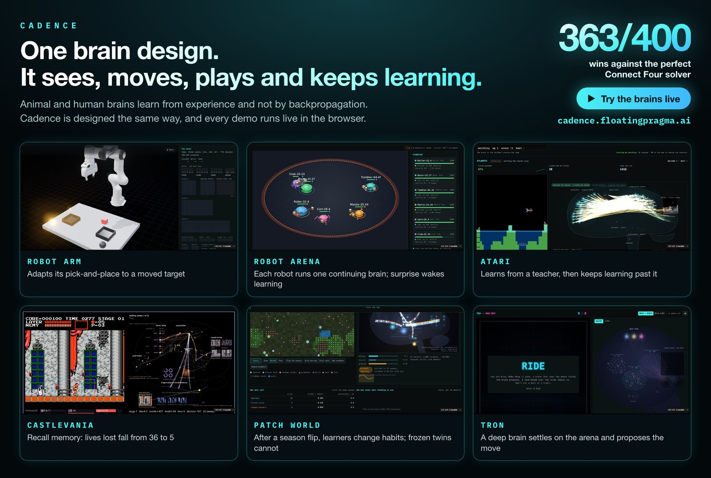

# Cadence demos

<p align="center">
  <a href="https://cadence.floatingpragma.ai/"></a>
</p>
<h3 align="center">▶ <a href="https://cadence.floatingpragma.ai/">Try them live in your browser: cadence.floatingpragma.ai</a></h3>

Small example applications for [Cadence](https://github.com/muellerberndt/cadence):
brains that learn from experience through bounded patches, local relations,
readback and settlement. Each demo demonstrates a specific mechanism and names
its implementation and evidence. These are bounded examples, not complete
recipes for the intended continuing brain.

> **Early research.** Cadence is under heavy early research. These demos are
> imperfect and change as the library changes.

## What the demos show

Cadence's functional target is an animal-like continuing brain that acquires
reusable knowledge, retains context and adapts to witnessed outcomes. This is
a software design goal, not a claim that these demos reproduce biological
learning or can learn every human task. The demos expose parts of that goal:

- **Live learning.** Acquired knowledge can remain useful while the same brain
  continues acting and learning. Bootstrap, ordinary settled behavior and
  evidence-driven repair have distinct roles and costs. A new observation
  need not trigger a supervised update.
- **Adapting to new conditions.** When the body or the world changes, the live
  brain adjusts from what it measures, without being told what changed.
- **Evolving brains.** The layout of a brain can be inherited, mutated and
  selected, so its size and shape are earned by what they cost and return.
- **Answers that settle.** An action is the settled state of the whole brain,
  and a brain that does not settle refuses to answer.
- **Declared learning mechanisms.** The brains repair from local relations
  and measured outcomes, and each README states the learning rule it uses.

## The brain in Cadence

The intended application builds one continuing brain through `Brain.compose`.
**System 1** is the default and may be deep and modular: an
animal-like brain with perception, plastic connections, memory, action and
private imagination. **System 2** is optional: observing regions add recursive
feedback inside the same brain. Its reciprocal patches settle together, using
short-term context and durable acquired knowledge. The canonical
[world-model guide](https://github.com/muellerberndt/cadence/blob/main/docs/world-model.md)
specifies the operating model for new applications.

Bootstrap should acquire reusable regularities of the task's world. Normal
behavior continues from useful retained state and reads that knowledge. A
witnessed mismatch or failure can admit local repair, attached to the actual
observation or executed action. Declare what each memory writes, retains,
reads and clears, and preserve correction identity across delay, retry and
save/load. A memory object that never affects behavior is insufficient.

The goal is competent repeated behavior with low recurring work after
acquisition. Test it against cold-reset and independent-input controls, memory
interventions, novel events and an explicit repair schedule control. Account
for initial acquisition, memory, sensing, all solves, replay and refused work.
Neither a small residual nor a demo's `pass` or `WIN` label proves correct
behavior, low physical energy or a performance advantage.

## How a Cadence brain differs from a feed-forward network

A conventional independent-input MLP control computes its answer in one pass
and uses a separate supervised update. Such a control is useful for comparison;
the ongoing state, memory and repair contract must be tested separately.

A Cadence brain reaches its answer by settling. Its patches are connected in
both directions. Each patch repairs its own disagreement with the patches it
reads, and the repairs repeat until the whole brain agrees within a tolerance.
That equilibrium supplies the candidate answer. Agreement with the equations
does not establish agreement with the world; behavior must be checked against
what actually happens.

When observed evidence calls for learning, the declared local rule repairs the
relevant relations so that later free behavior can improve. Continuing state
and acquired knowledge should make familiar situations cheaper to handle.
Whether that works is measured; replacing every independent classification
update with an iterative solve does not establish this operating model.

A Cadence brain can be deep. Depth adds populations or regions to the one
settlement, and the learning stays local at every depth.

| | Feed-forward deep network | Cadence brain |
| --- | --- | --- |
| An answer | The output of one pass through the layers | The settled state of the whole brain, a consensus among its patches |
| Influence while answering | Input to output only | Both ways: patches read one another and settle together |
| Learning | An output error sent backwards through every layer | An outcome disturbs the equilibrium, local repair settles a new one |
| Depth | More layers in the forward and the backward pass | More patches in the same settlement |
| Lifetime in this comparison | Independent inputs and explicit supervised updates | Bootstrap, continuing settled behavior and witnessed local repair |

Tron and Connect Four draw every neuron of the settle sweep by sweep, Atari Arcade shows the
settled state behind every action, and Eyes shows the whole brain settling for one eye's stream. The library README has
[the full comparison](https://github.com/muellerberndt/cadence#how-a-cadence-brain-differs-from-a-feed-forward-network).

## The demos

Every demo runs on `cadence-net` 0.95.2.

| Demo | What it shows | Runs on |
| --- | --- | --- |
| [Tron](tron/) · [live](https://cadence.floatingpragma.ai/demos/tron) | Ride a light cycle against a flat or a deep brain that sees the whole arena, and watch every neuron settle on its move | `Brain.compose`, flat (256) and deep (256-128-32); in the browser, the released library itself, in Pyodide |
| [Connect Four](connect-four/) · [live](https://cadence.floatingpragma.ai/demos/connect-four) | Play a deep brain that judges every position (loss, draw, win) beside its move, and teach it a column | A deep `Brain.compose` (1024, 1024) with a verdict slot; in the browser, the released library itself, in Pyodide |
| [Castlevania](castlevania/) · [watch](https://cadence.floatingpragma.ai/demos/castlevania) | A brain plays the NES game from what its eye sees on the screen, on your own copy of the game | A deep `Brain.compose` with recall, raised by a savestate teacher and search; a local server runs the emulator |
| [Patch World](patch-world/) · [live](https://cadence.floatingpragma.ai/demos/patch-world) | Creatures with Cadence brains forage, get poisoned when the season turns, relearn and evolve; click one to watch its brain | One continuing `Brain.live` brain per creature, bred by evolution; in the browser, the released library itself, in Pyodide |
| [Atari Arcade](atari-arcade/) · [live](https://cadence.floatingpragma.ai/demos/atari-arcade) | Brains that learn Atari games from pixels: a teacher first, then reward | `Brain.compose` (System 1); in the browser, the released library itself, in Pyodide |
| [Robot Arena](robot-arena/) · [live](https://cadence.floatingpragma.ai/demos/robot-arena) | Robots built from parts, one continuing brain per robot, raised in a nursery and fighting live in the browser with a brain inspector | `Brain.compose` with one motor slot per motor, learning through `Brain.live`; in the browser, in Pyodide |
| [Robot Arm](robot-arm/) · [live](https://cadence.floatingpragma.ai/demos/robot-arm) | A Franka Panda that picks up a block and places it in the bin you choose, under contact physics; move the bin while it carries the block and it follows | A deep `Brain.compose` taught by a scripted teacher in MuJoCo; in the browser, MuJoCo as WebAssembly and the library in Pyodide |
| [Eyes](eyes/) · [live](https://cadence.floatingpragma.ai/demos/eyes) | One brain that follows every shape you drag with its own eye, from the page's pixels only | A raised visual brain run by `cadence.Brain`; in the browser, the released library itself, in Pyodide |
| [Connectome](connectome/) · [live](https://cadence.floatingpragma.ai/demos/connectome) | Teach a fish gaze circuit to hold, return and hold again on measured wiring; explore a larva with fixed connections | Cadence rate patches in JavaScript, with plastic fish connections and declared body models |

## Putting a demo on your own site

Each browser demo is a static folder: its page, its scripts and a `pack/` folder holding the
released `cadence-net` wheel, the brain and a manifest of SHA-256 hashes, which the page's worker
checks before it runs anything. Serve the folder unchanged (for example under `public/` of a
site), and link to its page or embed it in an iframe. A site that builds a page into its own
bundle names the pack's address in the host page's `<head>`:

```html
<meta name="cadence-pack" content="/demos/connect-four/pack/">
```

Without the tag a page uses `pack/` beside itself (Robot Arena: `/pack/`). The pack must be served
as files, not answered by a single-page app's fallback page. Pyodide and NumPy load from
jsDelivr on the first visit.

## [Tron](tron/): light cycles against a brain that sees the whole field

[Open it on the site](https://cadence.floatingpragma.ai/demos/tron).

Each move is one settle of the whole brain on the 24 × 24 arena, turned so that the rider's
heading points up. Two brains are on the page, picked by a switch in the header: a flat brain of
one region and a deep brain of three, whose deep layers decide three quarters of its moves. Both
were raised by imitation of a search bot, selection under expert iteration and self-play; the
deep one grew its layers from the flat one. The [Tron README](tron/README.md) has their
readings, and [TRAINING.md](tron/TRAINING.md) raises both routes from scratch.

```sh
python3 -m http.server 8831 --directory tron/web   # open http://localhost:8831/
```

## [Connect Four](connect-four/): a deep brain with a verdict

[Open it on the site](https://cadence.floatingpragma.ai/demos/connect-four).

The brain sees its own stones, yours and the cells where a stone would land, and settles on
seven column neurons and three more that judge the position for the side to move: loss, draw or
win. The page draws the settle sweep by sweep, shows the replies it imagines for you, and lets
you teach it a column with one lesson. The [Connect Four README](connect-four/README.md) has
its readings against a perfect solver and how it was trained.

```sh
python3 -m http.server 8790 --directory connect-four/web   # open http://localhost:8790/
```

## [Castlevania](castlevania/): a brain on the NES

[Open it on the site](https://cadence.floatingpragma.ai/demos/castlevania).

A brain plays Castlevania from a foveated eye on the screen around Simon, choosing the pad's
buttons each decision, beside its settled state and its recall memory. It was raised by a
teacher that searches ahead from emulator savestates. The game is not included: the demo runs
on your own ROM, which `simon/rom.py` checks against the expected hash.

```sh
cd castlevania && python -m simon.rom ~/roms && python server.py   # opens http://localhost:8846/
```

See the [Castlevania README](castlevania/README.md).

## [Patch World](patch-world/): creatures that learn the seasons

[Open it on the site](https://cadence.floatingpragma.ai/demos/patch-world).

Berries nourish in summer and sicken in winter, and nothing a creature senses says which season it
is. Each learner is one continuing Cadence brain that learns from what its own actions bring: a
poisoning surprises it, and the surprise wakes its learning. Beside the learners live frozen twins
(the same brains, never learning) and random walkers. Learners outlive their frozen twins (3,933
against 284 moments on fresh seeds), stop eating berries within a winter, and learn the second
winter faster than the first. A well-fed learner bears a child that inherits its brain and mutated
genes, so evolution runs in the page. Click a creature to watch its brain settle, its dopamine
and arousal, and the synapses a lesson changes.

```sh
python3 -m http.server 8793 --directory patch-world/web   # open http://localhost:8793/
```

See the [Patch World README](patch-world/README.md).

## [Atari Arcade](atari-arcade/): learning Atari games

[Open it on the site](https://cadence.floatingpragma.ai/demos/atari-arcade).

Brains born at server start learn Atari games from the raw screen while you
watch. Each one is a System 1 brain built with `Brain.compose`. It watches a
scripted teacher play, takes the controls once its own answers agree often
enough, and then keeps learning from the reward of its own actions. The page
shows the game beside the settled brain. Freeway and Atlantis also run entirely
in the browser: an Atari core and the released Cadence wheel, in Pyodide, in
web workers.

```sh
python3 -m http.server 8080 --directory atari-arcade/web   # the browser edition, http://localhost:8080/
```

See the [Atari Arcade README](atari-arcade/README.md) for the Python edition and the readings.

## [Robot Arena](robot-arena/): the Cadence Showcase League

[Open it on the site](https://cadence.floatingpragma.ai/demos/robot-arena).

Robots are built from a parts catalogue: a chassis, wheels or legs, arms with a spike, a
hammer or a spinner. Each robot is one continuing `Brain.compose` life whose motor cortex
has one slot per motor, so every motor is commanded by the same settled state. A newborn is
raised in a nursery against a dummy, passes a driving test, then fights six-robot royales in
a ring that closes and keeps learning from every fight. The page runs the roster live in a
web worker, saves each brain in the browser after every fight, and shows the selected
robot's senses, settled state, motor slots and arousal.

```sh
cd robot-arena/showcase-app && npm install && npm run build && npx vite preview --port 4173
```

See the [Robot Arena README](robot-arena/README.md) to raise a league and check the page.

## [Robot Arm](robot-arm/): pick and place under contact physics

[Open it on the site](https://cadence.floatingpragma.ai/demos/robot-arm).

A Franka Panda in MuJoCo picks up a block and places it in the bin that a lit lamp names. Its
brain is one deep `Brain.compose` with three hidden regions and the apical compartment. It learned
the job during its life by imitating a scripted teacher. A disclosed inverse-kinematics reflex
turns its centimetre moves into joint targets. The page runs MuJoCo as WebAssembly and the trained
brain in Pyodide, and draws every neuron after each decision. Drag the block and the bins, press
Run, and move the bin while the arm carries the block.

```sh
python3 -m http.server 8830 --directory robot-arm/site   # open http://localhost:8830/
```

See the [Robot Arm README](robot-arm/README.md) to train the brain, read it and check the page.

## [Eyes](eyes/): one brain, an eye on every shape

[Open it on the site](https://cadence.floatingpragma.ai/demos/eyes).

Shapes on a large surface, each followed by its own eye, by one Cadence brain
that runs in the browser tab and sees only the page's pixels. Each eye sees
sharply at its centre and coarsely around it, and sees what changed since the
last frame, so when you drag a shape away one saccade can bring it back. When
nothing moves, the brain settles nothing. The brain was raised offline and runs
frozen in the page.

```sh
python3 -m http.server 8797 --directory eyes/web   # open http://localhost:8797/
```

See the [Eyes README](eyes/README.md).

## [Connectome](connectome/): teach a compiled circuit

[Open it on the site](https://cadence.floatingpragma.ai/demos/connectome).

Measured animal wiring becomes a running Cadence patch net. Teach the fish **hold your
gaze**, then **let it return**, then hold again on the same brain. Its connection strengths
change through practice. Pausing learning retains them; reset starts them over.

The fish learns its gaze response from declared activity feedback. A fixed pilot supplies
swimming, hunting and escape. The Platynereis larva demonstrates a whole-body connectome
with fixed weights. The two preprints behind the construction are
[Agreement and Surprise](https://philpapers.org/rec/MUEAAS-2) and
[Cadence: Learning Through Local Patch Settlement](https://philpapers.org/rec/MUECAP-2).

```sh
python3 -m http.server 8800 --directory connectome/web   # open http://localhost:8800/
```

See the [Connectome README](connectome/README.md) to run, teach and check the demo.
