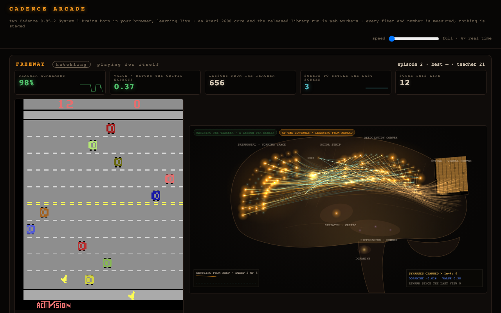

# Atari Arcade

**What it shows.** A Cadence brain learns during its life. Each brain is born in the browser
knowing nothing, learns a game in about a minute by watching a teacher play, then takes the
controls and plays in real time: the game never waits for it, and its working trace carries its
state from one screen to the next. In Freeway its games average above the teacher's: 22.0 to 22.5
crossings against 21.4 for three brains ([evidence/headless-0952/](evidence/headless-0952/)), and
21, 22, 27, 26 and 20 against the teacher's 21 in a run of the page
([evidence/promise-20261113.json](evidence/promise-20261113.json)). In Atlantis they tie with the
teacher's 2,000. A twin that stops learning at the takeover scores as well, so the edge comes from
what the brain learned by watching, not from the reward it learns from afterwards.
[The help page](web/help.html) explains every part of the page.

Brains born at start learn Atari games while you watch. Each brain is a Cadence 0.95.2
**System 1** brain on raw screen pixels. It begins as a hatchling and watches a scripted
teacher play. Once its own answers agree with the teacher's actions often enough it takes the
controls, and from then on it keeps learning from the reward of its own actions. The page
shows the game beside the settled brain: the retina, the association cortex and its working
trace, the motor cortex with one neuron per action, the value the critic expects, and the
score of every life with a skill badge from noob to legend.



The brain, its settings and its measured readings are summarized in [MODEL_CARD.md](MODEL_CARD.md).

Two editions run the same `Brain.compose` call from [arcade_brain.py](arcade_brain.py):

- **The browser edition** (`web/`) plays Freeway and Atlantis with nothing behind the page.
  The emulator is an Atari 2600 core in one web worker; the brain is the released
  `cadence-net` wheel running in Python (Pyodide) in a second worker.
- **The Python edition** (`server.py`) plays Atlantis, Freeway, Carnival and Space Invaders
  in the Arcade Learning Environment and streams them to a page.

This is a bounded teacher/reward demo. Its per-screen lessons are a bootstrap control, not
the general Cadence operating recipe. New work follows the
[world-model guide](https://github.com/muellerberndt/cadence/blob/main/docs/world-model.md):
acquire reusable relationships between perceptions, actions and consequences, retain context
and durable knowledge, and continue normal settled behavior; witnessed mismatches or
failures may admit local repair tied to the actual event.

## Run

The browser edition needs no install:

```sh
python3 -m http.server 8080 --directory web      # open http://localhost:8080/
```

The first visit downloads Pyodide and NumPy from jsDelivr. The wheel and `arcade_brain.py` are
in `web/pack/`; the worker checks each against the SHA-256 in `web/pack/manifest.json` before
it runs. `python pack.py` rebuilds the pack after a change to `arcade_brain.py`.

The Python edition, with Python 3.11 or later:

```sh
python3 -m venv .venv && .venv/bin/python -m pip install -r requirements.txt
.venv/bin/python server.py                       # open http://localhost:8668/
```

`ARCADE_GAMES` selects the games (default `Atlantis,Freeway,Carnival,SpaceInvaders`),
`ARCADE_RECALL=1` composes the recall memory (below), `ARCADE_RECIPE` patches the recipe in
`arcade_brain.py` (a JSON object or a path to one, such as `{"actor": {"eta": 0.0005}}`),
`ARCADE_PUBLIC=1` locks the speed control, `ARCADE_HOST` and `ARCADE_PORT` bind the server. Each game needs about one
processor core.

## What it demonstrates

- **Learning from pixels.** The brain's only input is the screen: 7,056 luminance values,
  84 by 84. No object positions, no emulator memory, no hand-made features.
- **A teacher first, then reward.** While the teacher plays, each watched screen is one
  lesson with the teacher's action as its label. After the takeover the only teaching signal
  is the game's reward for the actions the brain itself took.
- **A continuing brain through teacher and reward phases.** There is no model swap. The same
  brain answers and learns on every screen, before and after the takeover. After the
  takeover every decision is one call, `brain.step`.
- **A brain that takes its time beside a body that does not.** The game runs at its own pace
  and holds the brain's last action while the brain settles the next one.
- **Settling and refusal.** An action is read from the settled state of the whole brain. A
  solve that does not settle raises an error; the body then holds its last action and
  nothing is credited to the brain for that step.
- **A living brain beside a frozen twin.** `headless_control.py` runs two brains per game
  from one seed. One keeps learning after the takeover; the other receives no outcome at
  all. The report compares them.

## How it is built

The brain is composed once ([arcade_brain.py](arcade_brain.py)):

```python
from cadence import Brain, LearnerConfig

brain = Brain.compose(
    7056, n_actions, seed=seed, recall=False,      # 84 x 84 screen, one motor neuron per action
    learning=LearnerConfig(
        beta=0.1, temperature=0.2, tolerance=3e-3, free_steps=1024, nudged_steps=12,
        eta_bias=0.02, eta=0.003, momentum=0.9, normalize=0.99, normalize_floor=1e-4),
    actor_gamma=0.97, actor_lam=0.9, actor_eta=0.001, actor_eta_bias=0.0001,
    actor_eta_critic=0.3,
    backend="cpu",
)
```

`learning=` governs the teacher's lessons: each synapse steps on a running mean of its own
contrasts divided by their running size, because most pixels are quiet most of the time.
The bias step (0.02) is larger than the synapse step (0.003) on purpose, and the library
warns about it. `actor_eta` and `actor_eta_bias` govern actual reward through `step`, at the
small rates the library recommends for long reward lives; reward uses discount
`gamma=0.97` and eligibility decay `lam=0.9`. These are application choices, not library
defaults.

While the teacher plays, each screen the brain gets to see is one lesson. The brain first
gives its own answer, read greedily from its settled state, and then learns the teacher's
action as the label of that screen:

```python
drive = brain.stimulus(screen)                          # the screen, the working trace, memory
own = brain.act(screen, greedy=True)                    # the brain's own answer; not executed
brain.learner.step(drive, np.array([teacher_action]))   # the lesson
```

A greedy read carries no eligibility, so nothing is credited to the brain for an action it
did not take. The brain takes the controls after at least 500 lessons once 90% of its last
120 answers agreed, or after 2,000 lessons at the latest; the browser edition also waits
until it has watched one whole game of the teacher, since the badge needs that score. From
then on every decision is one call. The reward and the episode end describe the time since
the brain's previous decision:

```python
action = brain.step(screen, reward=reward, done=done)
```

Each game has two threads (two web workers in the browser). The body steps the emulator
sixty times a second, four times the console's speed, with the teacher's action while the
brain watches and the brain's last action afterwards. The brain's thread is its sole owner:
it always takes the latest screen, each screen at most once.

## Brain layout

| Part | Size | Role |
| --- | --- | --- |
| Sensory neurons | 7,056 | The screen, one neuron per pooled pixel |
| Association cortex | 64 | Reads the screen; exchanges activity with the motor cortex |
| Working trace | 64 | Holds the association cortex's activity of the moments before |
| Motor cortex | one neuron per action | The policy; neurons inhibit one another |
| Critic (basal ganglia) | reads the association cortex | Expected return; its error is the dopamine signal |
| Associative memory | 7,056 by actions | Reward recalled for each action in a similar screen |

A Freeway brain (three actions) has 7,187 neurons and 456,064 synapses; an Atlantis brain
(four actions) 7,188 and 456,192. All of them settle together for every decision, and an
answer is accepted only when the whole state satisfies the neural equations to tolerance.
This is System 1 without observers; `observers=(8,)` would add System 2 regions to the same
settlement.

**Recall.** `Brain.compose` gives a new brain the recall memory by default. The arcade turns
it off. The screen is the whole observation, and the memory adds two regions as wide as the
input: 21,300 neurons and 1,359,360 synapses for Atlantis. On one Apple M4 core with random
screens (NumPy only, without numba's compiled paths) it multiplies the cost of a greedy act from 22 to 593 ms, a lesson from 170 to 752 ms
and a reward step from 226 to 1,246 ms, so a body that never waits sees far fewer decisions.
In a whole run ([evidence/recall-0952/](evidence/recall-0952/), Freeway seed 0, same host and
conditions as the table below) the recall brain also passes every check, with living lives
averaging 22.2 against 22.5 without it, but its median handler takes 717 ms per screen
against 113, it took the controls 379 s after birth against 241, and it made 1,150 decisions
in its life against 5,528.

## What the brain receives

The Python edition's emulator is the Arcade Learning Environment (`ALE/<Game>-v5`): the
game's minimal action set, four frames per decision, sticky actions off. The browser's is an
Atari 2600 core ([6502.ts](https://github.com/6502ts/6502.ts)) behind an ALE-style interface
(`web/emulator/ale.js`, bundled into `web/emulator.js`; ROMs and licences in
`web/THIRD_PARTY.md`). The screen's luminance is pooled to 84 by 84. A fixed background, the
mean of 300 screens of random play taken before the brain is born, is subtracted and the
difference is doubled. That is the brain's whole input: one frame, no frame stack.

The reward the brain learns from is the sign of the game's reward since its previous
decision. The teachers are scripts. Freeway's always presses UP and Atlantis's always fires
the centre gun; Carnival's and Space Invaders' read the player's position from emulator
memory. That reading never reaches the brain. The skill badge compares the brain's last five
lives with the teacher's own games.

## Measurement and evidence

`headless_control.py` ran every game for three seeds on `cadence-net==0.95.2` (Python 3.13.7,
NumPy 2.5.4, numba 0.68.1 present, so the library took its compiled CPU paths; one Apple M4
Mac shared with other jobs, three runs at a time). Each run has two brains born from one
seed: one keeps learning after the takeover, the other receives no outcome at all (the frozen
twin). Each lived at least twelve whole games at the controls. The reports are in
[evidence/headless-0952/](evidence/headless-0952/); each binds the hashes of `server.py`,
`arcade_brain.py` and `headless_control.py` it ran (`arcade_brain.py` before its
one-numba-thread line, which sets an environment default and nothing else).

| Game | Seed | Teacher alone | Takeover: lessons / agreement / time | Living: mean (lives) | Living: last five | Living: best | Frozen twin: mean (lives) | Faults / refused | Brain ms per screen: p50 / p95 | Checks |
| --- | --- | --- | --- | --- | --- | --- | --- | --- | --- | --- |
| Atlantis | 0 | 2,000 | 500 / 1.0 / 65.9 s | 2,007.7 (13) | 2020.0 | 2100.0 | 1,946.2 (13) | 0 / 0 | 68 / 321 | pass |
| Atlantis | 1 | 2,000 | 500 / 1.0 / 66.3 s | 2,000 (12) | 2000.0 | 2000.0 | 2,000 (13) | 0 / 0 | 75 / 326 | pass |
| Atlantis | 2 | 2,000 | 500 / 1.0 / 59.6 s | 2,000 (12) | 2000.0 | 2000.0 | 2,008.3 (12) | 0 / 0 | 70 / 325 | pass |
| Carnival | 0 | 540 | 1866 / 0.9 / 202.9 s | 496.7 (12) | 232.0 | 1160.0 | 788.6 (14) | 0 / 0 | 64 / 198 | fail: expert_via_selfplay, living_holds_or_beats_frozen |
| Carnival | 1 | 540 | 2000 / 0.875 / 206.0 s | 281.7 (12) | 176.0 | 560.0 | 260.0 (13) | 0 / 0 | 56 / 191 | fail: expert_via_selfplay, living_holds_or_beats_frozen |
| Carnival | 2 | 540 | 1594 / 0.9 / 175.6 s | 413.3 (12) | 504.0 | 960.0 | 676.8 (19) | 0 / 0 | 57 / 197 | fail: living_holds_or_beats_frozen |
| Freeway | 0 | 21.4 | 500 / 1.0 / 241.0 s | 22.5 (12) | 22.8 | 25.0 | 23.0 (12) | 0 / 0 | 113 / 506 | pass |
| Freeway | 1 | 21.4 | 500 / 1.0 / 237.8 s | 22.0 (12) | 22.0 | 27.0 | 23.3 (12) | 0 / 0 | 117 / 516 | pass |
| Freeway | 2 | 21.4 | 500 / 1.0 / 241.5 s | 22.2 (12) | 23.0 | 25.0 | 23.2 (12) | 0 / 0 | 116 / 519 | pass |
| SpaceInvaders | 0 | 225 | 939 / 0.9 / 81.5 s | 247.3 (15) | 303.0 | 410.0 | 250.4 (13) | 0 / 0 | 41 / 115 | pass |
| SpaceInvaders | 1 | 225 | 861 / 0.9 / 70.4 s | 253.3 (12) | 339.0 | 515.0 | 180.0 (16) | 0 / 0 | 41 / 107 | pass |
| SpaceInvaders | 2 | 225 | 554 / 0.9 / 43.6 s | 165.9 (16) | 156.0 | 575.0 | 216.2 (12) | 0 / 0 | 40 / 97 | fail: expert_via_selfplay, living_holds_or_beats_frozen |

"Teacher alone" is the mean of the teacher's own games. A check line passes when both brains
took the controls, neither faulted, the living brain's last five lives average at least 80%
of the teacher, and the living brain's last five are no lower than 90% of the frozen twin's.
The timing columns summarize the living brain's handler times: a watched screen's answer and
lesson, or a decision with its feedback, with bookkeeping and refusals, not the emulator or
rendering. They are wall times under the host's load; the game does not wait for the brain,
so a slower host means fewer screens seen and a later takeover in seconds.

What the runs show:

- **Freeway and Atlantis reach the teacher's level in every seed.** Freeway lives average
  22.0 to 22.5 against a teacher of 21.4, with single lives up to 27; Atlantis holds the
  teacher's 2,000. Both take the controls after 500 lessons with every one of the last 120
  answers in agreement.
- **Space Invaders passes two seeds of three.** Living lives average 166 to 253 against a
  teacher of 225; the last five of seeds 0 and 1 reach 303 and 339. Seed 2 falls back after
  the takeover.
- **Carnival does not pass.** Its teacher depends on the player's position, the gate reads
  0.875 to 0.9 agreement, and after the takeover the living brain's last five lives (176 to
  504) fall below the teacher's 540 and below the frozen twin.
- **No brain faulted and no decision was refused** in any of the 24 brains.

What they do not show:

- **A gain from reward.** The frozen twin does as well as the living brain in Freeway and
  Atlantis and better in Carnival. Learning from reward keeps the taught skill in the simple
  games; it does not improve on it, and in Carnival and one Space Invaders seed the living
  brain drifts into holding one action. Freeway's and Atlantis's teachers are a single held
  action.
- **Repeatable timing.** Which screens a brain sees depends on the machine, so two brains
  from one seed take over at slightly different lesson counts.

```sh
.venv/bin/python headless_control.py --seed 0 --games Freeway --episodes 12 --out report.json
```

## The settings search

The recipe above is the one the demo ships after a search for a recipe whose living brain
beats its teacher and its frozen twin more often. `headless_control.py` ran about 1,950 lives
(a living brain and its frozen twin per game and seed) on one 96-core machine, with the recipe
patched by `ARCADE_RECIPE`, in seven stages on fresh seeds each, every stage with its own base
arm on the same seeds. The arms and every stage's readings are in
[evidence/search-0952.json](evidence/search-0952.json). A recipe would ship only if, on fresh
seeds, it passed more seeds than the base recipe in Carnival and Space Invaders and no fewer in
any game. None did.

| Arm, on the 20 seeds of stage 5 | Carnival | Space Invaders | Freeway | Atlantis |
| --- | --- | --- | --- | --- |
| The shipped recipe | 4 | 12 | 20 | 20 |
| `actor_eta` 5e-4, teaching until 1,500 lessons and 0.95 agreement (at most 4,000) | 5 | 13 | 19 | 20 |
| the same with the efference copy | 5 | 11 | 19 | 20 |
| the efference copy and the longer teaching | 2 | 14 | 19 | 19 |
| `actor_eta` 5e-4, the longer teaching, a teaching bias step of 0.002 | 2 | 14 | 20 | 20 |

- **Selection on a few seeds does not hold.** The best arm of stage 6 (`actor_eta` 5e-4, the
  longer teaching, `actor_gamma` 0.99 and `actor_lam` 0.95) passed Carnival 5 of 12 seeds
  against the base recipe's 2; on the fresh seeds of stage 7 it passed 0 of 13 against 4 of 16.
- **What the arms do change.** With `actor_eta` 5e-4 and the longer teaching the living brain
  ends nearer its frozen twin in Carnival (last five lives 0.85 to 1.04 of the twin's, against
  0.74) and further above it in Space Invaders (1.23 against 1.08); the pass counts stay within
  the seeds' spread.
- **What did not help.** Lower actor rates (3e-4, 2e-4, 1e-4), a slower or faster critic, a
  longer reward horizon, faster or slower teaching, a lower temperature and the efference copy,
  each alone. `Brain.live` (calm moments learn nothing) raises Atlantis above its teacher and
  costs Freeway (it passed 1 to 3 seeds of 3 to 12). A wider (96, 128) or deeper (64, 32 with
  `teaching="deep"`) association region costs 1.3 to 3 times as much per screen and passes no
  more seeds. The recall memory costs about six times as much per screen and was left out.
- **Carnival's limit is its teacher.** It fires three screens of four and moves on the fourth,
  by a clock no single screen shows, so a brain that reads one screen agrees with it about 0.9
  at best and both brains stay near 0.6 of its score.

## The brain view

The page draws each brain as a stylized brain seen from the left side, front to the left. Every
lit pixel comes from the brain's state at that moment, sent by the worker with each view; each
population sits where the animal-brain region whose role it plays sits, and a question mark on
each part explains what it does. The outline, its folds and the slow camera sway are drawing.

| Region drawn | Cadence population | What lights it |
| --- | --- | --- |
| Visual cortex, at the back | the 7,056 sensory neurons | the 84 x 84 retina, drawn as the screen on the occipital surface |
| Association cortex | association, 64 neurons | each neuron's settled activation (warm positive, cool negative) |
| Prefrontal cortex | working trace, 64 neurons | the association cortex's activity of the moments before |
| Motor strip | motor, one neuron per action, named | activation; the executed action gold; while watching, the teacher's action green and a disagreeing own answer red |
| Striatum | the critic | the value it expects from this screen |
| Midbrain dopamine nucleus | the critic's prediction error | a gold wash (burst) or blue wash (dip) over the striatum and cortex after each paid outcome, sized by the dopamine |
| Hippocampus | the associative memory | reward recalled per action for a similar screen |

- **Fibre tracts.** About 780 of the brain's synapses are drawn (the strongest of a random
  tenth per tract), bundled through one waypoint per pair of regions. A fibre's brightness is
  `|weight x presynaptic activation|` relative to its tract's strongest synapse; warm fibres
  excite, cool fibres inhibit.
- **Settling.** Every second view carries the screen's settle replayed from rest, sweep by
  sweep, with the same drive, budget and tolerance the brain's own settle uses (the brain's own
  settle starts from its previous state). The page plays it as a wave over the regions, with the
  sweep count and the largest movement per sweep falling to the tolerance.
- **Plasticity.** A drawn synapse whose weight moved by more than 1e-4 since the last view
  flashes gold and thickens; the panel counts every synapse of the brain that moved that much.
- **Phase and arousal.** Chips show whether the brain is watching the teacher (a lesson per
  screen) or at the controls (learning from reward); a brain living by `Brain.live` also shows
  calm (dim, nothing learned) or aroused (bright, learning).

`check_page.py` reads the frame time of every brain view on screen: 18.1 ms on average (p95
20.4 ms) in headless Chromium on the shared Mac, and the view data costs each screen about
1.1 times what it cost without it.

## The browser edition, checked

`check_page.py` opens the page in a headless browser and checks its promise: both brains are
born on the 0.95.2 wheel, learn from the teacher, take the controls and keep playing, with no
fault, refusal or page error, and that the brain view draws at 30 frames a second or more. Its
last reading is [evidence/page_check.json](evidence/page_check.json): every check passed; in
headless Chromium on the Mac shared with other jobs, Atlantis took the controls after 500
lessons and Freeway after 656 (it also waits for the teacher's first whole game), 39 and 52
seconds after the page opened, and both then played at a median of 79 to 81 ms per screen, with
no fault or refusal.

```sh
python check_page.py --shot docs/browser.png      # needs Playwright and its Chromium
```

`tests/` checks the recipe, a watched-then-rewarded tape that continues identically after
save and load, the brain side through a takeover, and that the pack holds the released wheel
and the current `arcade_brain.py`.
