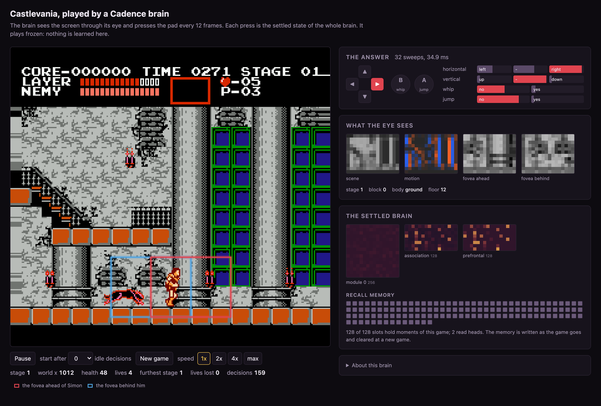

# Castlevania

A Cadence brain plays NES Castlevania from the screen. Every 12 frames its eye reads the
picture and a few RAM readings, the whole brain settles, and the settled motor slots press the
pad: left or right, up or down, whip, jump. The page shows the game beside what the eye sees,
the settled regions, the answer per slot and the recall memory filling as the game goes. The
brain plays frozen; nothing is learned while you watch.



Runs on `cadence-net==0.95.2` and `stable-retro==1.0.1`. The game is not included: you need your
own dump of the cartridge.

## Run it

```sh
cd castlevania
python3 -m venv .venv && .venv/bin/python -m pip install -r requirements.txt
.venv/bin/python -m simon.rom ~/roms        # finds your Castlevania (U) (PRG1) dump and copies it in
.venv/bin/python server.py                  # open http://localhost:8846/
```

`simon.rom` checks every `.nes` file it is given (a file or a folder) and copies the one whose
SHA-1 without the 16-byte iNES header is `3dcb69a8c861c041aeb56c04e39adf6d332eda3a` to
`integration/Castlevania-Nes-v0/rom.nes`, which `.gitignore` keeps out of the repository.
stable-retro's own `python -m stable_retro.import` expects the other printing of the cartridge
(PRG0), so it does not apply here. The brain was raised on PRG1 and is only checked there.

The page polls the local server, which runs the FCEUmm core and the brain in one thread at the
game's speed (1x, 2x, 4x or as fast as the brain answers). New game powers the console on;
"start after N idle decisions" lets the game run on for N decisions first, which changes where
the enemies are when Simon starts.

## The brain

```python
Brain.compose(827, 10, slots=(3, 3, 2, 2), modules=(256, 128), apical=0.25, arousal=True,
              memory_choice=True, recall=True, recall_heads=2, recall_action=True,
              recall_boundary=True, recall_position=32, recall_recency=0,
              learning=LearnerConfig(eta=0.2, eta_bias=0.02, beta=0.1, temperature=0.2,
                                     nudged_steps=32, nudged_fixed=True, qualified=False))
```

Two hidden regions (256 and 128 neurons) with the apical compartment, a prefrontal region that
carries the working trace, four motor slots, and a recall memory of 128 slots read by two heads,
whose keys include the command the body actually executed. 4,697 neurons (the recall memory's regions included) and 724,736 synapses
(`describe()` on the shipped file).

- **Acts.** Each decision `Brain.act(x, greedy=True)` settles the whole brain warm from the
  previous decision's state; the strongest motor neuron of each slot is the answer, held on the
  pad for 12 frames (five decisions a second at the game's speed).
- **Memories.** Synapses: written by lessons in training, frozen here. Working trace and recall
  memory: written at every act, read by the next settles, cleared when a new game starts
  (`Brain.reset`). The page shows how many recall slots are held.

## What the brain sees

827 numbers per decision ([`simon/eye.py`](simon/eye.py)):

| Slice | Count | Content |
| --- | --- | --- |
| scene | 192 | the gray frame, pooled to 12 x 16 cells |
| motion | 192 | the scene minus the previous decision's scene |
| fovea ahead | 192 | a 64 x 48 px window on Simon, 48 px ahead of him and 16 behind, pooled 4 x 4 |
| body | 12 | screen x and y, scroll, world x, health, lives, stage, facing, the last command's facing, whip and jump |
| fovea behind | 192 | the same window mirrored about Simon |
| stage, block, body state, floor | 47 | one-hot readings from RAM |

Simon's position, facing and body state come from RAM; everything inside the windows is pixels.
The page draws the four pixel maps and the one-hot readings. The red box on the game is the
fovea ahead, the blue box the fovea behind.

## How it learned

The brain imitated a scripted teacher ([`training/teacher.py`](training/teacher.py)) that reads
console RAM: routes for each stage (stairs, jumps, headings), the whip for enemies in reach, and a
savestate lookahead at the giant bat. The teacher alone reaches stage 4 on ten of ten power-on
starts. The brain never reads RAM beyond the eye's position readings.

1. **Pools.** Teacher games from power-on (24 idle offsets, with 0 to 15 percent of random
   actions) give 25,098 practice states: emulator savestates with the eye's observation, the
   teacher's memory and its next labels ([`training/harvest.py`](training/harvest.py)).
2. **Practice.** Segments of 40 decisions start at drawn practice states, weighted towards the
   hard places (the hall stairs, stage 2, the bat). Eight segments run side by side in one
   emulator. Every decision the teacher labels each stream's state, the brain takes one
   `Brain.lesson` on all eight rows, weighting rows at critical places three times, then acts;
   the teacher's action is executed ([`training/train.py`](training/train.py)).
3. **A wider eye.** The brain first learned 200,000 decisions this way, one stream at a time on
   an earlier release of the library, with the first 588 inputs of the eye. Its checkpoint was
   carried to this release, and [`training/widen.py`](training/widen.py) carried every learned
   array onto the full 827-input eye, the new inputs' synapses at zero: on 400 held-out
   positions the widened brain answers as before on every one.


## Readings

Frozen and greedy from power-on, 1,500 decisions on each of nine idle offsets (0, 3, 7, 10, 14,
21, 28, 35, 42), `training/evaluate.py`; the receipt is [`evidence/receipt.json`](evidence/receipt.json).

| Start | Furthest stage | Lives lost | Where the lives went |
| --- | --- | --- | --- |
| 0, 7, 10, 14, 28, 35 | 2 | 4 | stage 2, at the bottom-left staircase |
| 3, 42 | 2 | 4 | stage 1 once, then stage 2 |
| 21 | 2 | 4 | stage 1 and stage 2 |

Every start passes the hall's stairs at the end of stage 1 (9 of 9); none reaches stage 3.

## Limits

- **Stage 2.** At the bottom left of stage 2 the route goes down a staircase into the
  underground. The brain walks there but stops a few pixels short of the staircase's foot and
  holds down, which crouches, until enemies take its lives.
- **Imitation, not reward.** The brain learned from a teacher's labels; the world's reward
  played no part, and nothing is learned while you watch.
- **RAM in the eye.** Simon's position, facing, stage, block and body state come from RAM; the
  rest is pixels.
- **One cartridge.** Raised and checked on the PRG1 printing on stable-retro's FCEUmm core only.

## Train your own

Everything runs from the `castlevania/` folder with the ROM imported. The steps are CPU-bound; a
brain of this size takes about 20 ms per decision with eight streams on one core of a c7i, so a
run of 200,000 decisions takes a little over an hour, and the search phase about 0.4 s per
searched decision.

```sh
pip install -r requirements.txt pytest
python training/teacher.py --decisions 2500 --noops 0 1 2      # the teacher alone
for n in 0 2 4 6 8 10 12 14 16 18 20 22; do                     # the practice pool, one game per process
  python training/harvest.py --part train --train-noops $n --epsilons 0.0 0.05 0.15 --out runs/pool/parts/train_n$n &
done; wait
python training/harvest.py --part val --out runs/pool/parts/val_all
python training/merge_pools.py runs/pool
python training/train.py --config '{"name": "a", "seed": 0, "budget": 200000,
    "genes": {"memory_choice": true, "recall_heads": 2, "recall_action": true, "recall_boundary": true,
              "recall_position": 32, "recall_recency": 0, "apical": 0.25, "teach_eta": 0.2}}' --out runs/a
python training/train.py --config '{"name": "b", "seed": 0, "budget": 260000, "load": "runs/a/end.brain.npz",
    "load_decisions": 200000, "search_at": 200000}' --out runs/b          # then the search phase
python training/evaluate.py --brains runs/b/end.brain.npz --out runs/eval.json
python training/pack.py --brain runs/b/end.brain.npz --readings runs/eval.json --run runs/b/result.json
```

`train.py` options: `streams`, `segment`, `budget`, `draw` (the practice places and their
weights), `critical_weight`, `search_at`, `search_share` (0 runs the brain's own moves with the
teacher's labels, DAgger), `search_k`, `search_horizon`, `search_sims`, `c_puct`, `backend`
(`"mlx"` on Apple silicon), `load`. `--resume` continues a run from its newest checkpoint. Every
evaluation writes a checkpoint `d<N>.brain.npz` and a line per start to `readings.jsonl`.

**The search phase** is expert iteration at one ply, the AlphaZero recipe with the emulator as
the model: on a share of the rows, the brain's memory-free settle gives priors over the 36 pad
actions; its likeliest actions and the teacher's are each executed from the savestate and rolled
out 16 decisions by the teacher's heuristic; the rollouts' progress (world x, a new block, a
stage clear; less lost health and lives) and PUCT visits over the priors give visit shares, and
`Brain.lesson(x, targets=shares)` teaches them. Where the rollouts cannot tell the candidates
apart, the row is taught the teacher's label. The most visited action is executed. The search
is used in training only; the page plays the brain alone.

## Layout

| Path | What |
| --- | --- |
| `server.py`, `web/` | the local server and the page |
| `simon/` | the pad, the eye, the console (`Console`), the player, the ROM import |
| `brain/brain.npz` | the brain the page plays |
| `integration/Castlevania-Nes-v0/` | stable-retro's description of the game, with the PRG1 hash; your `rom.nes` goes here |
| `training/` | the teacher, the pools, the trainer with the search, the widening of a brain's eye, the evaluation |
| `evidence/` | the receipt of the shipped brain and its readings |
| `tests/` | the brain loads and answers on the released library, without a ROM |

```sh
.venv/bin/python -m pip install pytest && .venv/bin/python -m pytest tests -q
```

## Licence

The code is MIT, as the rest of this repository. The game and its ROM are Konami's and are not
distributed here.
