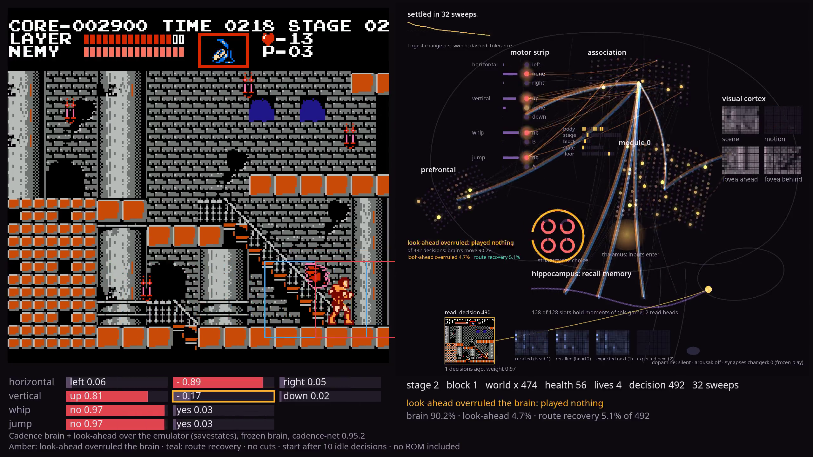
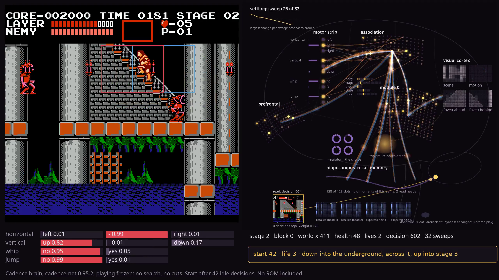
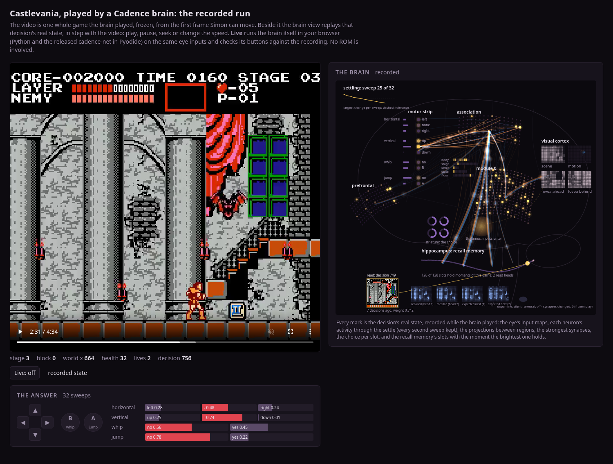

# Castlevania

**What it shows.** A Cadence brain with real memory and a real state, running in real time. A
frozen brain plays NES Castlevania from what its eye sees, with a recall memory of this game's
moments and a state it carries from one decision to the next, five decisions a second. A
look-ahead on the emulator checks its moves near enemies: together they reach stage 3 on all nine
selection starts, and lives lost fall from 36 (the brain alone) to 5
(`evidence/lookahead_receipt.json`). The look-ahead is not the brain: 93 of every 100 moves played
are the brain's own, and the giant bat is not beaten. The demos site serves [`player/`](player/)
(two recordings and the brain running in your browser; no ROM); its [help page](player/help.html)
explains every part of the screen, what you can do and the limits, and on the page every part
explains itself (a small **?**).

A Cadence brain plays NES Castlevania from the screen. Every 12 frames its eye reads the
picture and a few RAM readings, the whole brain settles, and the settled motor slots press the
pad: left or right, up or down, whip, jump. The page shows the game beside what the eye sees,
the settled regions, the answer per slot and the recall memory filling as the game goes. The
brain plays frozen; nothing is learned while you watch. Started with `--lookahead`, a look-ahead
over the emulator's savestates checks the brain's moves near enemies and overrules the few it
finds clearly worse, marked on the page.


Runs on `cadence-net==0.95.2` and `stable-retro==1.0.1`. The game is not included: you need your
own dump of the cartridge.

## Watch it play

The videos on top play the brain with a look-ahead over the emulator beside it (see [Cadence
brain + look-ahead over the emulator](#cadence-brain--look-ahead-over-the-emulator)): the frozen
brain proposes every move, and near enemies the look-ahead checks it against a few safer moves on
the emulator's savestates and overrules it when another loses clearly less. The brain alone, the
brain's own record, follows below them.

[](docs/castlevania-highlights.mp4)

**Highlights, brain + look-ahead** ([`docs/castlevania-highlights.mp4`](docs/castlevania-highlights.mp4),
1440p, 60 frames a second; [`720p`](docs/castlevania-highlights-720p.mp4); a short loop
[`docs/castlevania-highlights.webm`](docs/castlevania-highlights.webm)): three stretches of two
recorded games, each played as recorded. A card marks each cut, and a caption names the start, the
life and the clip's three shares (the brain's own move, the look-ahead overruling it, route
recovery); the brain view marks each overruled decision amber and each route-recovery decision teal:

1. Start after 21 idle decisions, life 1 (0:13 to 0:52 of that game): the hall, its zombies and a
   bat, up its stairs into stage 2, no health lost.
2. Start after 10 idle decisions, life 1 (1:19 to 1:58): past a fishman, through the
   underground, up its exit stairs into stage 3.
3. Start after 21 idle decisions, life 1 (2:00 to 2:36): the giant bat wakes; Simon keeps out of its
   swoops.

**The whole game, uncut** ([`docs/castlevania-run.mp4`](docs/castlevania-run.mp4), 1440p;
[`720p`](docs/castlevania-run-720p.mp4)): start after 21 idle decisions, 1,500 decisions from the
first frame Simon can move, brain + look-ahead, every decision's kind marked; per-decision log in
[`evidence/castlevania-run.json`](evidence/castlevania-run.json). Of its 1,500 decisions the brain's
own move was played on 1,407 (93.8%), the look-ahead overruled it on 65 (4.3%), route recovery
played 28 (1.9%).

| Time | |
| --- | --- |
| 0:00 to 0:52 | The courtyard and the hall, up the stairs at its end into stage 2; no health lost |
| 0:52 to 1:46 | Stage 2: down the bottom-left staircase, through the underground, up its exit stairs and into stage 3; three hits |
| by 2:00 | The giant bat wakes |
| 2:00 to 5:02 | The bat fight: Simon holds the arena's right side (world x 751) from about 2:20, takes four hits (2:07, 2:44, 3:20, 3:53) and the bat loses 8 of its 64 health; after the fourth hit, at two bars of health, the bat does not reach him again before decision 1,500 |

No life is lost in this game; it does not beat the bat.

### The brain alone

[](docs/castlevania-brain-alone-highlights.mp4)

**Highlights** ([`docs/castlevania-brain-alone-highlights.mp4`](docs/castlevania-brain-alone-highlights.mp4), 1440p, 60
frames a second; [`720p`](docs/castlevania-brain-alone-highlights-720p.mp4); a short loop
[`docs/castlevania-brain-alone-highlights.webm`](docs/castlevania-brain-alone-highlights.webm)): two stretches of one
recorded game of the packed brain, frozen and greedy, no search, each played as recorded. A card
marks each cut, and a caption names the start and the life:

1. Start after 42 idle decisions, life 1 (0:00 to 0:57 of the game): the courtyard, the hall and
   up its stairs into stage 2.
2. The same game, life 3 (1:38 to 2:18): down the stage-2 staircase into the underground, across
   it, up its exit stairs and into stage 3, the giant bat's stage.

**The whole game, uncut** ([`docs/castlevania-brain-alone-run.mp4`](docs/castlevania-brain-alone-run.mp4), 1440p;
[`720p`](docs/castlevania-brain-alone-run-720p.mp4)): the same game from the first frame Simon can move to the
game over, with the page's brain view settling on every decision:

| Time | |
| --- | --- |
| 0:00 to 0:56 | Life 1: the courtyard and the hall, up the stairs at its end into stage 2 |
| 1:20 | Life 1 lost in stage 2, at the bottom-left staircase |
| 1:30 to 1:37 | Life 2: down into the underground; lost there |
| 1:45 to 2:14 | Life 3: down into the underground, across it, up its exit stairs, through stage 2's exit and into stage 3 |
| 2:14 to 2:53 | Life 3 in stage 3, towards the giant bat; lost there |
| 2:53 to 4:32 | Life 4: the fight with the giant bat, which loses 36 of its 64 health; game over |

The game's first block ends with that bat. The brain has not beaten it. The per-decision log is
[`evidence/castlevania-brain-alone-run.json`](evidence/castlevania-brain-alone-run.json).
[`record.py`](record.py) makes the videos from your own ROM (`python record.py --idle 42`,
`--scale 2` for 1440p, `--lookahead` for the brain + look-ahead): it plays the game and the brain and draws every frame with the page's own
renderer (`web/render.html` in a headless Chromium), piped to ffmpeg;
[`highlights.py`](highlights.py) cuts the highlights from that recording and its log.

**The recorded runs beside the brain, in your browser** ([`player/`](player/)): a static page with
two recordings. *Brain + look-ahead* plays the highlights above. *Brain alone* plays the game
video and drives the brain view from the recorded trace, in step with play, pause, seek and speed
changes; its live mode runs the brain itself in the tab (Pyodide and the released wheel) on the
recorded eye inputs and checks its buttons against the recording. See [Player](#player) below.

Stage numbers here are the game's RAM counter: stage 0 is the courtyard and stage 1 the hall (the
screen shows both as STAGE 01), stage 2 is the screen's STAGE 02 and stage 3 its STAGE 03.

## Run it

```sh
cd castlevania
python3 -m venv .venv && .venv/bin/python -m pip install -r requirements.txt
.venv/bin/python -m simon.rom ~/roms        # finds your Castlevania (U) (PRG1) dump and copies it in
.venv/bin/python server.py                  # open http://localhost:8846/
.venv/bin/python server.py --lookahead      # the brain + look-ahead over the emulator
```

`simon.rom` checks every `.nes` file it is given (a file or a folder) and copies the one whose
SHA-1 without the 16-byte iNES header is `3dcb69a8c861c041aeb56c04e39adf6d332eda3a` to
`integration/Castlevania-Nes-v0/rom.nes`, which `.gitignore` keeps out of the repository.
stable-retro's own `python -m stable_retro.import` expects the other printing of the cartridge
(PRG0), so it does not apply here. The brain was raised on PRG1 and is only checked there.

The page polls the local server, which runs the FCEUmm core and the brain in one thread at the
game's speed (1x, 2x, 4x or as fast as the brain answers). New game powers the console on;
"start after N idle decisions" lets the game run on for N decisions first, which changes where
the enemies are when Simon starts.

## Player

[`player/`](player/) is a static page (no server, no ROM) and a folder a static host serves by
itself: the demos site serves it as `/demos/castlevania/`. Its pack holds copies of the brain and
of the two videos, and the page's `brain.js` and `style.css` are copies of `web/`'s
(`tests/test_player_page.py` checks every copy and hash; git stores each copy once). Its first
recording, *Brain + look-ahead*, plays the highlights
([`docs/castlevania-highlights.mp4`](docs/castlevania-highlights.mp4)) with the page's
explanations over the parts of each frame. Its second, *Brain alone*, plays the game video
([`docs/castlevania-game.mp4`](docs/castlevania-game.mp4), the game alone, the same run as the
brain-alone videos above) beside the brain view, driven from a trace of that run
([`player/pack/trace.json.gz`](player/pack/trace.json.gz), 6.7 MB). The trace holds, per decision,
the first video frame it covers, the eye's exact input (float64), the settle (every second sweep,
as bytes), the projections, the strongest synapses, the choice per slot and the recall slots'
reads, and the frame each decision saw (for the recall view). The page follows the video's own
frame (`requestVideoFrameCallback` where the browser has it): play, pause, seek and speed changes
stay in step.



**Live** runs the brain itself in the tab: Pyodide, the released `cadence-net` 0.95.2 wheel, the
demo's own player code and the brain, each checked against `player/pack/manifest.json`'s SHA-256
(the page reads the pack from `<meta name="cadence-pack">`, else `pack/` beside it). It feeds the
recorded eye inputs in order from the game's start, settles each one for real, draws its own
state, and counts how many of its chosen buttons equal the recording's. If it falls behind the
video it says by how many decisions.

```sh
python -m http.server 8846 --directory castlevania/player   # open http://localhost:8846/
python player/pack.py --trace <record.py --trace output>   # rebuild the pack
python player/check_player.py --live 60                    # the brain-alone recording, headless
python tools/promise_test.py --out evidence/promise_test-<date>.json   # the claim, on the page
```

Every control and every part of the brain on the page carries a small **?** whose card opens when
the pointer rests on it (the demos' shared `cadence-explain.js`); *Help* opens
[`player/help.html`](player/help.html). `tools/promise_test.py` plays the claim on the page served
from `player/` alone: the highlights load, match their hash and play; the brain view follows the
brain-alone video; its recall memory fills with the game's moments; live mode presses the
recorded buttons; and the claim's numbers are those of `evidence/lookahead_receipt.json` (record:
`evidence/promise_test-20261113.json`).

[`player/check_player.py`](player/check_player.py) (`player/evidence/player_check.json`, headless
Chromium on a c7i): the page plays, stays on the decision the video shows after a seek to 2:30, a
pause and 2x speed; frame time 16.7 ms (median and 95th percentile); live mode loaded in 6.3 s and
chose the recorded buttons on 60 of the first 60 decisions, 99 ms a decision (real time needs 200).
Pyodide's NumPy is 32-bit; one shim in `player/worker.js` (the same as the Eyes demo's) casts the
library's `np.repeat` slot counts to its index type.

## The brain view

The page draws the brain as an animal brain seen from the left, front on the left, and every mark
is that decision's real state. Hover a region for the population that plays its role.

- **Visual cortex** (back): the eye's four input maps, scene, motion, fovea ahead and fovea behind,
  and beside them the **body-sense strip**: the body readings and the one-hot stage, block, body
  state and floor. They are the sensory population, 827 neurons, clamped each decision. Their glow
  at the **thalamus** is the mean input.
- **Module 0** (256 neurons), the **association** region (128), the hub every other region reads
  and writes, and the **prefrontal** region (128), which carries the working trace. Each neuron is
  drawn at its activity sweep by sweep through the settle, coloured over its region's range at that
  decision.
- **Tracts** between regions: bundled curves whose width is |weight × presynaptic activity| summed
  over the projection, warm for excitatory flow and cool for inhibitory. Thin threads are the
  strongest single synapses of each projection.
- **Motor strip and striatum**: the ten motor neurons in their four slots, each choice's softmax
  probability, and the chosen one in red once the settle has finished.
- **Hippocampus**: the recall memory's 128 slots, one moment of this game each. Slots light gold
  when this decision's read attends them, and a thread runs from the brightest slot to the frame it
  holds. Below are the scene parts of what each read head recalls and of what each expects next.
- **The settle**: the sweep count and the largest change per sweep falling to the tolerance.
- **With the look-ahead** (`--lookahead`), beside the striatum: an amber arc and the move played
  when the look-ahead overruled the brain's choice, a teal arc when a route-recovery move was played,
  and the running shares of the three kinds of decision. The motor strip and striatum always show
  the brain's own choice; the page's pad lights what was played.
- **Dopamine, arousal, plasticity** are shown at their true state in frozen play: silent, off,
  zero synapses changed.

## The brain

```python
Brain.compose(827, 10, slots=(3, 3, 2, 2), modules=(256, 128), apical=0.25, arousal=True,
              memory_choice=True, recall=True, recall_heads=2, recall_action=True,
              recall_boundary=True, recall_position=32, recall_recency=0,
              learning=LearnerConfig(eta=0.2, eta_bias=0.02, beta=0.1, temperature=0.2,
                                     nudged_steps=32, nudged_fixed=True, qualified=False))
```

Two hidden regions (256 and 128 neurons) with the apical compartment, a prefrontal region that
carries the working trace, four motor slots, and a recall memory of 128 slots read by two heads,
whose keys include the command the body actually executed. 4,697 neurons (the recall memory's regions included) and 724,736 synapses
(`describe()` on the shipped file).

- **Acts.** Each decision `Brain.act(x, greedy=True)` settles the whole brain warm from the
  previous decision's state; the strongest motor neuron of each slot is the answer, held on the
  pad for 12 frames (five decisions a second at the game's speed).
- **Memories.** Synapses: written by lessons in training, frozen here. Working trace and recall
  memory: written at every act, read by the next settles, cleared when a new game starts
  (`Brain.reset`). The page shows how many recall slots are held.

## What the brain sees

827 numbers per decision ([`simon/eye.py`](simon/eye.py)):

| Slice | Count | Content |
| --- | --- | --- |
| scene | 192 | the gray frame, pooled to 12 x 16 cells |
| motion | 192 | the scene minus the previous decision's scene |
| fovea ahead | 192 | a 64 x 48 px window on Simon, 48 px ahead of him and 16 behind, pooled 4 x 4 |
| body | 12 | screen x and y, scroll, world x, health, lives, stage, facing, the last command's facing, whip and jump |
| fovea behind | 192 | the same window mirrored about Simon |
| stage, block, body state, floor | 47 | one-hot readings from RAM |

Simon's position, facing and body state come from RAM; everything inside the windows is pixels.
The page draws the four pixel maps and the one-hot readings. The red box on the game is the
fovea ahead, the blue box the fovea behind.

## How it learned

The brain imitated a scripted teacher ([`training/teacher.py`](training/teacher.py)) that reads
console RAM: routes for each stage (stairs, jumps, headings), the whip for enemies in reach, and a
savestate lookahead at the giant bat. The teacher alone reaches stage 4 on ten of ten power-on
starts. The brain never reads RAM beyond the eye's position readings.

1. **Pools.** Teacher games from power-on (24 idle offsets, with 0 to 15 percent of random
   actions) give 25,098 practice states: emulator savestates with the eye's observation, the
   teacher's memory and its next labels ([`training/harvest.py`](training/harvest.py)).
2. **Practice.** Segments of 40 decisions start at drawn practice states, weighted towards the
   hard places (the hall stairs, stage 2, the bat). Eight segments run side by side in one
   emulator. Every decision the teacher labels each stream's state, the brain takes one
   `Brain.lesson` on all eight rows, weighting rows at critical places three times, then acts;
   the teacher's action is executed ([`training/train.py`](training/train.py)).
3. **A wider eye.** The brain first learned 200,000 decisions this way, one stream at a time on
   an earlier release of the library, with the first 588 inputs of the eye. Its checkpoint was
   carried to this release, and [`training/widen.py`](training/widen.py) carried every learned
   array onto the full 827-input eye, the new inputs' synapses at zero: on 400 held-out
   positions the widened brain answers as before on every one.
4. **Stage 2.** 125,120 more decisions of practice on this release, eight streams, with the
   draw weighted to stage 2 (the staircase down to the underground, the water jumps, the way
   out): about an hour on one core of a c7i.
5. **Its own path (DAgger).** 100,160 decisions in which the brain drives and the teacher labels
   every state the brain reaches, with the same stage-2 draw: the lessons come from where the brain
   actually goes, including its own mistakes. Eight streams on one core of a c7i. For the last
   25,280 of them the teacher had learned to leave the low ledge past the underground's exit stairs
   (it jumps back left onto the floor), the place where the brain used to stand until its life ran
   out. Of the run's checkpoints, read every 25,000 decisions, the one at 425,280 is packed.

## Readings

Frozen and greedy from power-on, 1,500 decisions per start (`training/evaluate.py`; the receipt
is [`evidence/receipt.json`](evidence/receipt.json)). The checkpoints of the runs were compared on
nine selection starts and this one was picked there; nine fresh starts were read once, after the
pick.

| Starts (idle decisions) | Past the hall stairs | Down the stage-2 staircase and across the underground | Stage 3, the giant bat's stage |
| --- | --- | --- | --- |
| Fresh: 1, 5, 11, 17, 25, 31, 38, 45, 49 | 9 of 9 | 8 of 9 | 2 of 9 |
| Selection: 0, 3, 7, 10, 14, 21, 28, 35, 42 | 9 of 9 | 9 of 9 | 3 of 9 |
| The previous brain, fresh starts | 9 of 9 | 8 of 9 | 0 of 9 |
| The previous brain, selection starts | 9 of 9 | 6 of 9 | 0 of 9 |

Every start ends with its four lives lost (fresh starts: 20 deaths in stage 2, 5 in stage 1, 2 in
stage 3). Across the underground means down the staircase at the bottom left of stage 2 and on
through the underground. Where the brain reaches stage 3 it goes on to the giant bat's arena
(world x 664); on selection start 42 it takes 36 of the bat's 64 health before its last life ends.
A checkpoint replaces the packed brain only if it is no worse on both sets of starts and no start
leaves the brain standing still.

## Cadence brain + look-ahead over the emulator

`python server.py --lookahead` (and `record.py --lookahead`) plays the same frozen brain with a
look-ahead beside it, the pattern of the Connect Four and Tron demos
([`simon/lookahead.py`](simon/lookahead.py)). Every decision the brain settles and proposes its
buttons. Where a hostile object is near (100 px across, 64 px up or down) or Simon stands at one
of two known trouble spots (the foot of stage 2's bottom-left staircase and the low ledge past the
underground's exit), the look-ahead saves the emulator state and plays the brain's proposal and a
few candidates of the damage-averse teacher in [`training/teacher.py`](training/teacher.py) (wait,
whip, turn and whip, crouch and whip, jump on, step or jump away) out 12
decisions each, the route heuristic after each, scoring health and lives lost with a small credit
for progress. It restores the state and plays the brain's move unless a candidate loses clearly
less (the proposal carries a bonus of two health points); an overruling candidate's first two
moves are played. Elsewhere the brain plays alone. The look-ahead reads the console's object
table and savestates; the brain sees only through its eye, as always, and nothing is learned.

Two guards keep it moving. A wait can only postpone a hit the horizon cannot see past (a panther
on its ledge leaps when Simon walks up), so after 8 decisions of overruling without 8 px of
progress the look-ahead stands down for 6 decisions and overrules only to save a life. And where
the brain has made no progress along the route for 40 decisions (outside the giant bat's fight),
the route heuristic's move stands in for the brain's proposal for 30 decisions, still checked by
the look-ahead: **route recovery**.

Every decision is one of three, counted separately everywhere (the receipt, the captions, the
brain view: amber for the look-ahead, teal for route recovery):

| Starts (1,500 decisions each) | Brain's own move played | Look-ahead overruled the brain | Route recovery |
| --- | --- | --- | --- |
| Selection: 0, 3, 7, 10, 14, 21, 28, 35, 42 | 93.2% | 4.2% | 2.7% |
| Fresh: 1, 5, 11, 17, 25, 31, 38, 45, 49 | 93.2% | 4.1% | 2.7% |

Against the same brain alone, on the same starts and the same damage reading
([`evidence/lookahead_receipt.json`](evidence/lookahead_receipt.json)):

| Reading | Selection, brain alone | Selection, + look-ahead | Fresh, brain alone | Fresh, + look-ahead |
| --- | --- | --- | --- | --- |
| Health lost: hall / stage 2 / stage 3 | 520 / 952 / 176 | 96 / 136 / 432 | 712 / 1,080 / 56 | 80 / 152 / 384 |
| Health lost, all | 1,648 | 664 | 1,848 | 616 |
| Lives lost: hall / stage 2 / stage 3 | 2 / 30 / 4 | 0 / 0 / 5 | 5 / 29 / 2 | 0 / 0 / 4 |
| Lives lost, all (of 36) | 36 | 5 | 36 | 4 |
| Past the hall stairs | 9 of 9 | 9 of 9 | 9 of 9 | 9 of 9 |
| Across the underground | 9 of 9 | 9 of 9 | 8 of 9 | 9 of 9 |
| Stage 3 reached | 3 of 9 | 9 of 9 | 2 of 9 | 9 of 9 |
| Direction reversals per 100 decisions | 4.32 | 3.22 | 3.55 | 3.47 |
| Jumps per 100 decisions | 0.50 | 2.01 | 0.40 | 1.81 |
| Starts flagged still (no progress and no life lost in the last 600 decisions) | 0 | 5 | 0 | 5 |

The starts flagged still are a standoff at the giant bat, not a stall on the route. On the two
probed (selection starts 7 and 21) Simon reaches the bat's arena in stage 3 by decision 600 to
700; the bat loses 16 and 8 of its 64 health; Simon's health falls to two of its sixteen bars; and
from about decision 1,100 the look-ahead keeps him at the arena's right wall (world x 751) out of
the bat's way, neither side losing more, until decision 1,500. The look-ahead has not beaten the
bat either.

Limits of this mode:

- **Not a brain-alone result.** Every move the look-ahead overrules, and every route-recovery move,
  comes from a search over the emulator's savestates and the teacher's route, not from the brain.
  The brain-alone readings above and in [Readings](#readings) are the brain's own record.
- **More time and damage in stage 3, and no win at the bat.** Every start reaches stage 3 and
  spends most of its 1,500 decisions there, so stage 3 loses more health and about as many lives
  as with the brain alone (which reaches it on 3 and 2 of 9 starts). It ends in a standoff with the
  giant bat, not a win.
- **More jumps.** Jumping on and away are candidates, so it jumps about four times as often as the
  brain alone (2 against 0.5 per 100 decisions).
- **Slower.** A checked decision plays 16 rollouts of 12 decisions on the emulator (about a second
  on a busy c7i core), so near enemies the page falls behind the game's speed.

## Limits

- **Stage 2 and the bat.** The game's first block ends with the giant bat at stage 3. The brain
  reaches it on 2 of 9 fresh starts and has not beaten it. Elsewhere it loses its lives in stage 2:
  some starts stop a few pixels short of the bottom-left staircase's foot and hold down, which
  crouches; some cross the underground and drop past the staircase up and out onto the low ledge.
- **Imitation, not reward.** The brain learned from a teacher's labels; the world's reward
  played no part, and nothing is learned while you watch.
- **RAM in the eye.** Simon's position, facing, stage, block and body state come from RAM; the
  rest is pixels.
- **The look-ahead is not the brain.** The top videos and `--lookahead` mix the brain's moves
  (93% of decisions) with the look-ahead's overrules and route-recovery moves (about 4% and 3%).
  Their damage and progress belong to that mix; the brain's own record is the brain-alone video
  and the readings above. See [its limits](#cadence-brain--look-ahead-over-the-emulator).
- **One cartridge.** Raised and checked on the PRG1 printing on stable-retro's FCEUmm core only.

## Train your own

Everything runs from the `castlevania/` folder with the ROM imported. The steps are CPU-bound; a
brain of this size takes about 20 ms per decision with eight streams on one core of a c7i, so a
run of 200,000 decisions takes a little over an hour, and the search phase about 0.4 s per
searched decision.

```sh
pip install -r requirements.txt pytest
python training/teacher.py --decisions 2500 --noops 0 1 2      # the teacher alone
for n in 0 2 4 6 8 10 12 14 16 18 20 22; do                     # the practice pool, one game per process
  python training/harvest.py --part train --train-noops $n --epsilons 0.0 0.05 0.15 --out runs/pool/parts/train_n$n &
done; wait
python training/harvest.py --part val --out runs/pool/parts/val_all
python training/merge_pools.py runs/pool
python training/train.py --config '{"name": "a", "seed": 0, "budget": 200000,
    "genes": {"memory_choice": true, "recall_heads": 2, "recall_action": true, "recall_boundary": true,
              "recall_position": 32, "recall_recency": 0, "apical": 0.25, "teach_eta": 0.2}}' --out runs/a
python training/train.py --config '{"name": "b", "seed": 0, "budget": 260000, "load": "runs/a/end.brain.npz",
    "load_decisions": 200000, "search_at": 200000}' --out runs/b          # then the search phase
python training/evaluate.py --brains runs/b/end.brain.npz --out runs/eval.json
python training/pack.py --brain runs/b/end.brain.npz --readings runs/eval.json --run runs/b/result.json
```

`train.py` options: `streams`, `segment`, `budget`, `draw` (the practice places and their
weights), `critical_weight`, `search_at`, `search_share` (0 runs the brain's own moves with the
teacher's labels, DAgger), `search_k`, `search_horizon`, `search_sims`, `c_puct`, `backend`
(`"mlx"` on Apple silicon), `load`. `--resume` continues a run from its newest checkpoint. Every
evaluation writes a checkpoint `d<N>.brain.npz` and a line per start to `readings.jsonl`.

**The search phase** is expert iteration at one ply, the AlphaZero recipe with the emulator as
the model: on a share of the rows, the brain's memory-free settle gives priors over the 36 pad
actions; its likeliest actions and the teacher's are each executed from the savestate and rolled
out 16 decisions by the teacher's heuristic; the rollouts' progress (world x, a new block, a
stage clear; less lost health and lives) and PUCT visits over the priors give visit shares, and
`Brain.lesson(x, targets=shares)` teaches them. Where the rollouts cannot tell the candidates
apart, the row is taught the teacher's label. The most visited action is executed. The search
is used in training only; the page plays the brain alone unless started with `--lookahead`.

## Layout

| Path | What |
| --- | --- |
| `server.py`, `web/` | the local server and the page |
| `player/` | the static page the demos site serves: two recordings, the brain view, live mode, the help page |
| `site.json`, `tools/promise_test.py` | the claim on the demos site, and the claim played on the page |
| `simon/` | the pad, the eye, the console (`Console`, with savestates), the player, the look-ahead (`lookahead.py`), the ROM import |
| `brain/brain.npz` | the brain the page plays |
| `integration/Castlevania-Nes-v0/` | stable-retro's description of the game, with the PRG1 hash; your `rom.nes` goes here |
| `training/` | the teacher, the pools, the trainer with the search, the widening of a brain's eye, the evaluation |
| `evidence/` | the receipt of the shipped brain and its readings, the look-ahead's receipt, the per-decision logs of both full games |
| `tests/` | the brain loads and answers on the released library, and the look-ahead overrules and restores on a toy console, without a ROM |

```sh
.venv/bin/python -m pip install pytest && .venv/bin/python -m pytest tests -q
```

## Licence

GPL-3.0, as Cadence ([`LICENSE`](LICENSE)). The game and its ROM are Konami's and are not
distributed here.
