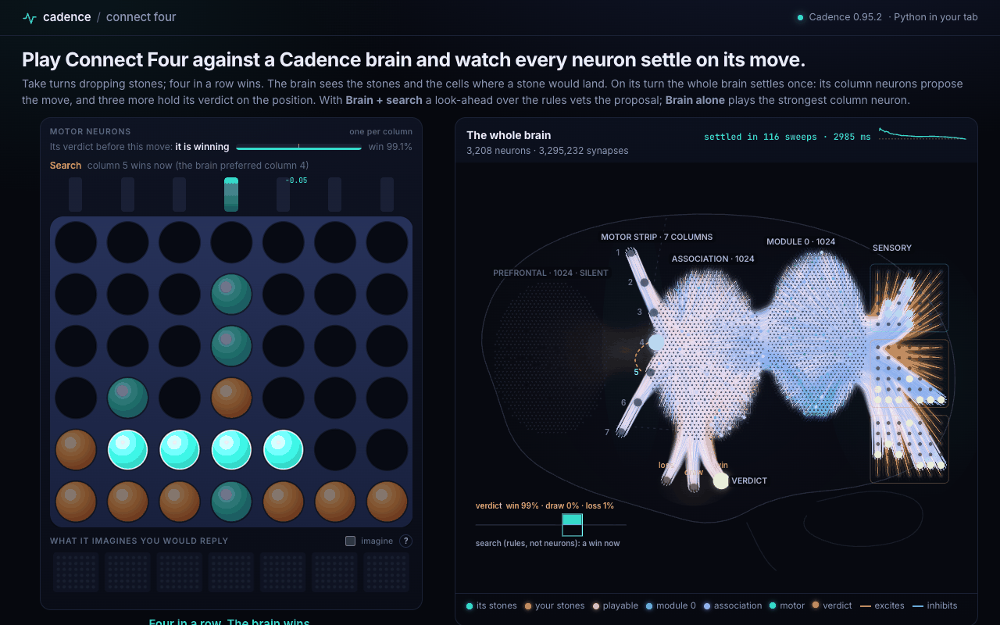

# Connect Four

Play Connect Four against a deep Cadence brain and watch every neuron settle on its move. You
and the brain take turns dropping stones; four in a row wins. On its turn the whole brain
settles once on the board it sees, and the page draws that settle sweep by sweep: every neuron
and the synapses carrying its messages. Three of its motor neurons hold its verdict on the
position (loss, draw or win for the side to move). By default the brain plays with a search:
it proposes its columns, and a look-ahead over the rules of the game vets them. *Brain alone*
plays the settle's strongest column. The browser runs the actual Python brain in a Web Worker
through Pyodide, with NumPy and the released `cadence-net==0.95.2` wheel. No server or model
service chooses the moves.



```sh
python -m http.server -d connect-four/web 8790   # open http://localhost:8790/
```

The first visit downloads Pyodide 314.0.7 and NumPy from jsDelivr and the 25 MB brain from this
folder. The wheel, the Python host and the brain are bundled in `web/pack/`; the worker checks
each against the SHA-256 in `web/pack/manifest.json` before anything runs.

## The brain

```python
Brain.compose(126, 10, modules=(1024, 1024), slots=(7, 3), apical=0.25,
              working_memory_amplitude=0.0, episodic=False)
```

taught at the normalized teaching point with a projection-relative floor of 0.1 and nudged
phases of a fixed 32 sweeps. 3,208 neurons and 3,295,232 synapses.

- **Senses:** 126 inputs in {0, 1}, row-major from the bottom left (cell `r*7 + c`, row 0 at the
  bottom): the 42 cells of the side to move (on its turn, the brain), the opponent's 42 cells,
  and the 42 cells where a stone dropped in each column would land.
- **Acts:** `state = brain.learner.free(brain.stimulus(x, memory=False))`. The motor activations
  are `state.activation[:, brain.learner.output_index]`: seven column neurons, then three
  verdict neurons. The move is the strongest column neuron among the columns that still have
  room. The verdict is taught beside the move; the move does not read it.
- **Settles:** every move settles the whole brain from rest, without memory. A position is fully
  observed, so nothing is carried from one move to the next. The settle stops at the first sweep
  in which no activation moves by 0.003, within a budget of 1,024 sweeps.
- **Populations:** sensory (126), `module_0` (1,024), association (1,024), prefrontal (1,024) and
  motor (10). The synapses run sensory→`module_0` (dense), `module_0`↔association and
  association↔motor (reciprocal, a quarter of them on the apical compartment), and
  prefrontal→association. The prefrontal region is where Cadence's working trace enters; in a
  memory-free settle it stays at rest and the page shows it as silent.

## The two players

- **Brain alone:** the strongest column neuron among the columns with room, from one settle.
- **Brain + search** (the default, labelled on the page): the same settle, then a negamax search
  with alpha-beta pruning over the game's rules (`connect4/search.py`): bitboards, a
  transposition table and iterative deepening within a budget of 120,000 positions a move. At
  its horizon it counts threats, the empty cells where a stone would complete four for either
  side, weighted by the row parity that lets that side use them; wins and losses inside the
  horizon are exact. The move: a win the search proves is played; columns it proves lost are
  dropped while any other remains; among the rest the brain's strongest column is played unless
  the search scores another higher by more than 0.25 (on a scale where a proven result is
  ±1,000 and a horizon score lies within ±0.9). The brain's seven column neurons, as a softmax
  at its temperature, rank the columns; its verdict is reported and does not enter the search.
  The search knows the rules, not the solver's scores, and nothing in it learns. In the page it
  runs in JavaScript in the worker, after the brain's settle (`web/search.js`, a port of
  `connect4/search.py` that returns the same values, depth and positions visited on every one of
  200 recorded positions: `tests/parity_search.mjs`), so the measured games below hold for the
  page.

## What the page shows

- **The board,** with the seven column neurons as bars above their columns, rising sweep by
  sweep, and after each of its moves the brain's verdict on the position it moved from and,
  with the search, what the search did: kept the brain's column, overruled it, or found a forced
  win, how many moves ahead it read and how many positions it visited.
- **The whole brain, as a brain seen from the side** (front to the left). Each population sits in
  the region whose role it plays, and hovering a neuron names that role; the roles are analogies,
  not claims that the populations are those regions:
  - the three 6 × 7 input boards (its stones, yours, the playable cells) at the back, where vision
    is;
  - `module_0`, which reads the boards, beside them, each neuron placed by the board cells it reads;
  - the association field in the middle, each neuron placed by the column it drives;
  - the prefrontal region at the front, silent (the working trace's target, unused in a
    memory-free settle);
  - the seven column neurons along a motor strip; the three verdict neurons deep below.

  The synapses run as bundled fibre tracts between the regions, each leaving its neuron, joining
  the tract to its target region and leaving it at its target. A synapse glows with the message it
  carries, |weight × presynaptic activation|: warm when it excites, cool when it inhibits. Blocks
  of more than 150,000 synapses are drawn by the eight strongest synapses into each neuron (174,080
  of the 3.3 million are drawn). Each region glows with its population's mean activation in the
  current sweep, so the settle shows as activity spreading from the boards through the regions and
  back. Hover or tap a neuron to see its activation, its bias and its strongest inputs now. After a move a deliberation panel shows the verdict and what the search
  (labelled as rules, not neurons) found for each column: proven wins and losses, the horizon's
  scores, the column it played, and a dashed arc where it overruled the brain's column neuron.
- **The settle, sweep by sweep,** in chunks of 12 sweeps posted as soon as they exist, with a
  sparkline of the largest activation change against the tolerance. Chunking changes nothing:
  the tests check the sweep count, the last frame and the move against one `Learner.free` call.
- **What it imagines you would reply** (off by default; tick *imagine*). Before its move,
  `Brain.imagine` privately settles the brain on the board each column would leave, read from
  your seat, and draws the reply it would make there. Nothing in the brain changes, and its move
  does not read these replies. It settles seven boards together, which adds several seconds a
  move in the browser.
- **Teach it.** After a brain move, tap the column it should have played. The worker runs one
  `brain.lesson` on that board, labelled with your column and the verdict the brain holds now.
  Only a column the brain does not already play is taught. The page's lessons step at 0.0033
  (the bias at a tenth of that), so one or two lessons show; the brain's own moves do not depend
  on that rate. The largest synaptic changes flash gold. Columns the brain does not play often
  rest at the activation floor (−0.1); a lesson then shows as the taught column becoming the
  move rather than as a rising bar. The changed synapses flash along their tracts, gold where they
  strengthened and blue where they weakened, with the number changed. Lessons live in the tab;
  *Reset brain* or a reload restores the shipped brain.
- **Game controls:** *Brain + search* or *Brain alone*, new game, who starts, undo, keys 1–7,
  and a collapsed model card with the sizes, the training, the readings, the timings in this tab
  and the provenance.

## How it learned

Offline, from a perfect Connect Four solver ([Pascal Pons'
solver](https://github.com/PascalPons/connect4)), in stages, each continuing the brain of the
one before:

| Stage | Lessons | Rows a lesson | What was taught |
| --- | --- | --- | --- |
| 1 | 2,000 | 256 | from a fresh brain: the solver's centre-most optimal column, or the brain's own column where it keeps the theoretical result; the verdict |
| 2 | 58,000 | 256 | the same, on the GPU in float32 |
| 3 | 20,000 | 512 | the same at a third of the rate, annealed once more at a plateau |

Every lesson taught every row of its batch. A batch draws from three million positions of games
of the solver against itself (deliberate mistakes, short random openings, each position also
mirrored): a quarter of it positions with a win to take or a win to block, an eighth finished
boards seen by the loser (verdict: loss). Every 1,000 lessons the brain plays 64 games against
the solver and 16 more from the empty board; their positions join the pool, and each move that
slipped is shown four more times.

## Measured

The brain alone, `training/c4train/reading.py` on the packed brain, loaded on the CPU (record:
`evidence/reading.json`):

| Reading | |
| --- | --- |
| The solver's optimal move, 3,000 held-out positions | 77.3% |
| A move that keeps the theoretical result, where the mover is not already lost | 92.3% |
| An immediate win taken | 68.0% |
| A forced block made | 85.3% |
| The verdict agrees with the solver's result | 89.2% |

The held-out positions come from solver games that were never taught.

Games from the empty board, both players, `training/c4train/play_search.py` (record:
`evidence/search_reading.json`). The solver at 1.0 is the perfect solver; at 0.9 and 0.7 it
plays a random column one move in ten and three in ten. Counts are won, drawn, lost for the
brain's side:

| Opponent | Brain alone | Brain + search |
| --- | --- | --- |
| The perfect solver, the brain first | 119-50-31 (200 games, `evidence/reading.json`) | 363-25-12 (400 games) |
| The perfect solver, the brain second | 0-0-40 | 0-0-40 |
| The solver at 0.9, the brain first | 29-10-1 | 38-1-1 |
| The solver at 0.9, the brain second | 12-7-21 | 62-13-45 (120 games) |
| The solver at 0.7, the brain first | 30-6-4 | 36-2-2 |
| The solver at 0.7, the brain second | 27-4-9 | 37-2-1 |
| Brain + search against the brain alone, search first | | 34-5-1 |
| Brain + search against the brain alone, search second | | 24-3-13 |

The perfect solver wins every game it starts. Each row is 40 games unless it says otherwise;
games against the brain alone begin with two random moves, since both players are otherwise
deterministic. The record also holds other budgets and depth rules, moving first against the
perfect solver (200 games each unless stated): 40,000 positions 163-14-23, 80,000 135-5-20 (160
games), 300,000 170-4-26; at 120,000 with only even or only odd finished depths 172-12-16 and
181-5-14. A larger budget does not read stronger here: the horizon's threat count favours one
side or the other with the depth it reaches. Natively the search at 120,000 took a median of
0.6 s a move.

`check_page.py` ran the page in headless Chromium on an Apple M4 (record:
`evidence/page_check.json`) while the machine ran other jobs (load average 13 to 18). With brain +
search: starting Pyodide, NumPy, Cadence and the brain took 25 s; over a whole game a settle took
54–116 sweeps and 1.2–3.0 s in the worker, the search 0.30–0.53 s (9 to 12 moves ahead), a whole
move 1.6–3.0 s, and from a click to the brain's stone on the board 3.9–5.2 s, about 2 s of it the
animation of the two stones and the settle; the brain view drew 51 frames per second while the
brain settled.

## Train it further

The training code is in `training/`. It needs the solver:

```sh
cd connect-four/training
git clone https://github.com/PascalPons/connect4 pons
curl -L -o pons/7x6.book https://github.com/PascalPons/connect4/releases/download/book/7x6.book
cp bridge.cpp pons/ && (cd pons && make c4solver && g++ --std=c++11 -O3 -DNDEBUG -o c4bridge bridge.cpp Solver.o)
python -m venv .venv && .venv/bin/pip install "cadence-net[fast]==0.95.2"
```

A pool of solver-labelled positions (one solver per worker):

```sh
.venv/bin/python -m c4train.gen_pool --positions 1000000 --workers 8 --seed 1 --out runs/pool_1m.npz
```

Continue the packed brain on a CUDA GPU (1,000 lessons of 512 rows with their games and readings
took about 18 minutes on an A10G shared by two runs):

```sh
.venv/bin/pip install torch
.venv/bin/python -m c4train.train --arm cadence --modules 8 --init ../web/pack/brain.npz \
  --backend torch --device cuda:0 --precision float32 \
  --planes 3 --verdict --every-row --batch 512 --pool-file runs/pool_1m.npz \
  --target keepwin --soft 0.5 --tactics-weight 3 --tactics-share 0.25 --terminal-share 0.125 \
  --slip-weight 4 --own-every 1000 --own-games 64 --first-games 16 --first-weight 2 \
  --eval-every 1000 --games-every 5000 --games 40 --first-eval 40 \
  --patience-on score --lessons 20000 --out runs/continue
```

or on Apple silicon with MLX (`--backend mlx --precision float32`, after
`.venv/bin/pip install "cadence-net[apple,fast]==0.95.2"`). `--modules` is ignored when `--init` loads a brain; a fresh brain takes
`--modules 1024 1024 --apical 0.25 --relative 0.1 --nudged-steps 32 --nudged-fixed`.

The shipped brain was trained without the lesson options of 0.95.x; the command above continues
it with them:

- `--target keepwin`: as the brain's own column where it keeps the result, but a position with a
  win now is labelled with the winning column (a slower win also keeps the result, so the plain
  target never teaches taking it).
- `--soft 0.5`: `lesson(x, targets=p)` teaches a distribution per row: half on the label, half
  spread over the columns that keep the result (the winning columns where one wins now).
- `--tactics-weight 3`: `lesson(x, labels, weights=w)` weighs rows with a win to take or a win to
  block three times.

Continued from the packed brain for 5,000 lessons on an A10G with exactly these options, the brain
alone took more immediate wins (68% to 83% of held-out positions) and made more forced blocks (85%
to 95%), but kept the theoretical result less often (92.3% to 90.9%) and, moving first against the
perfect solver, scored 13-13-14 in 40 games; at three times the rate it fell to 84.9% and 0-25-15.
The packed brain is the one before that continuation.

`runs/continue/receipt.json` holds every reading; `policy_best.npz` is the brain with the best
`keep + 0.25 × (wins + blocks)` so far. Pack a brain for the page:

```sh
.venv/bin/python -m c4train.page_copy runs/continue/policy_best.npz page.npz
.venv/bin/python -m c4train.reading page.npz > ../evidence/reading.json
cd .. && python pack.py --brain training/page.npz --receipt training/runs/continue/receipt.json
```

`page_copy` zeroes the optimizer's running moments and stores the efficacies in float32 (the
precision the brain was trained in): the moves are unchanged and the file is a quarter of the
size. `pack.py` copies the brain, the receipt's numbers and the host into `web/pack/` with the
released wheel and a manifest of hashes.

## What it does not claim

- **The search is not the brain.** *Brain alone* plays from one settle per move. *Brain + search*
  adds a look-ahead over the rules with a hand-written threat count at its horizon; the brain
  ranks the columns, and the search vetoes the ones it proves lost and plays the wins it proves.
  Neither has an opening book or a memory of earlier moves; this is a settled policy over the
  board, not a continuing life with retained state.
- **Not a perfect player.** The readings above are the claim; a game in the page is one sample.
  The brain alone misses about a third of the immediate wins it could take; with the search it
  takes every win inside the horizon, and still loses some games it starts against perfect play.
- **The imagined replies** are the brain's private responses, not a model of you or of the game,
  and its move does not read them.
- **A settled state** certifies the settle's equations at the tolerance, not the quality of the
  move.
- **Brightness** is scaled per population, relative to its most active neuron in that settle;
  the tooltip shows raw values.

## Check

```sh
python -m venv .venv
.venv/bin/python -m pip install -r requirements.txt
.venv/bin/python -m playwright install --only-shell chromium
.venv/bin/python -m pytest tests -q
.venv/bin/python check_page.py
node tests/parity_search.mjs        # the page's search against connect4/search.py
```

The tests check the rules and the three-plane encoding, the search (wins it must take, blocks it
must make, cells it must not open, the brain's column where the search sees no difference), that the drawn settle is the
`Learner.free` readout sweep for sweep, the verdict readout, that a full column is never played,
the layout, the silent population at rest, an imagination that changes nothing, and a lesson that
changes synapses while a reset restores them. `check_page.py` serves `web/`, plays a whole game
by clicking with brain + search (the default), checks every answer is legal and the settle,
search and answer times, the brain view while
it settles, hover details, imagination when ticked, two lessons, undo, a new game with the brain
first, the model card, a reset, a phone-width layout and a browser without fast WebGL. Console
errors, page errors and failed requests fail it.

Pyodide's NumPy has a 32-bit index type; `connect4/host.fit_32_bit_numpy` gives the library's
learning module a NumPy whose `repeat` casts its counts. The shim does nothing on a 64-bit NumPy.

| Path | What |
| --- | --- |
| `connect4/` | what the page's worker runs: the rules and encoding (`game.py`), the drawn settle, the verdict, imagination, lessons and the layout (`host.py`), the search (`search.py`) |
| `web/` | the page: `app.js` (game, controls, readouts), `board.js`, `brain.js` (the brain view, WebGL2 and Canvas2D), `worker.js` (Pyodide), `search.js` and `squash.js` (the search, ported), `pack/` (wheel, host, brain, receipt, manifest) |
| `pack.py` | packs the wheel, the brain, the receipt's numbers and the host into `web/pack/` |
| `training/` | the trainer (`c4train`), the solver bridge, the readings and the page copy |
| `tests/`, `check_page.py` | the rules, the host and the search (Python), the search's port (`parity_search.mjs` with `fixtures/`); the page's promise in headless Chromium |
| `evidence/` | `reading.json`, `search_reading.json`, `page_check.json` |
| `MODEL_CARD.md` | the brain: composition, training, readings, limits |
| `docs/` | the screenshot |

Cadence and this example are GPL-3.0. Pascal Pons' solver, which the training uses and this
folder does not include, is AGPL-3.0.
