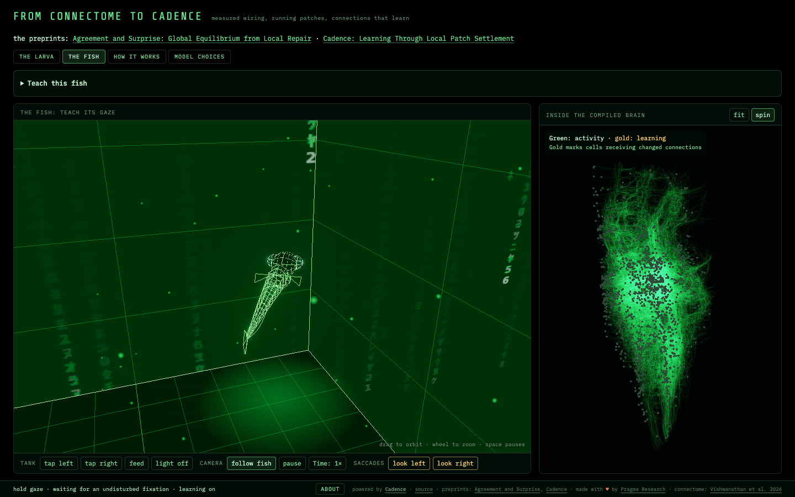
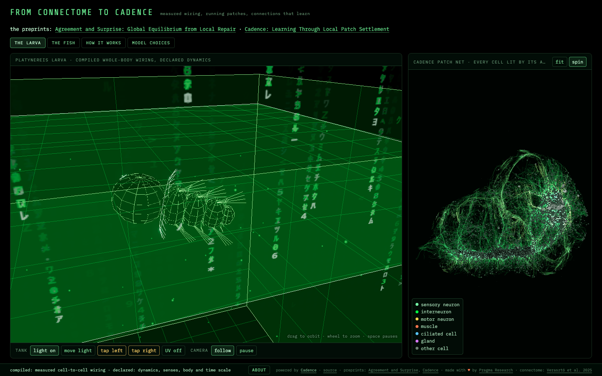

# From connectome to Cadence

## What it shows

**A Cadence brain on real animal wiring, which learns.** A connectome is the complete wiring
diagram of a nervous system: which cell connects to which, by how many synapses, traced cell by
cell in electron microscope images. Cadence runs two measured connectomes as live brains in the
browser: the whole body of a Platynereis larva (25,609 cells), whose wiring turns it toward light
and stops it after a tap, with fixed connections; and one side of a zebrafish hindbrain (2,884
neurons), whose gaze circuit holds a glance in its own activity. Teach the fish to hold its gaze,
let it return and hold again: the strengths of its measured connections change while it lives and
keep what they learned (12 of 12 seeded runs, `web/data/learning_reteach.json`). The page's
[help page](web/help.html) explains what a connectome is, every part of the screen, how the fish
learns, the numbers with their evidence files, and the limits. The site's text for the demo is
[`site.json`](site.json).

## The demo

Two animal connectomes running as Cadence rate patch nets. Teach the zebrafish's gaze
circuit to hold, return, and hold again on the same acquired brain. Explore the
Platynereis larva's compiled sensory and motor circuit, whose weights stay fixed.

The mathematical background: [Agreement and Surprise: Global Equilibrium from Local
Repair](https://philpapers.org/rec/MUEAAS-2) and [Cadence: Learning Through Local Patch
Settlement](https://philpapers.org/rec/MUECAP-2).





The [model card](MODEL_CARD.md) describes both compiled nets, how the fish learns and what was measured.

## Run

```sh
python3 -m http.server 8000 --directory web
```

Open [the fish](http://localhost:8000/fish.html) or [the larva](http://localhost:8000/).
Use HTTP; module imports and data loading need it. Deploy by serving `web/` as a static
site. No application server is required.

## Teach the fish

1. Expand **Teach this fish**, choose **hold your gaze**, and press **Teach this lesson**.
   Watch the gaze bars update as it learns. Practice ends by pausing learning and testing the response.
2. Choose **let it return** and teach again on the same brain.
3. Switch back to **hold your gaze** and compare the response after another practice.

**Time** sits beside **pause** in the tank controls. Lessons automatically run at 8×, then
restore the previous speed when they finish or stop. Click Time to choose 1×, 4× or 8×
during a lesson; that manual choice stays afterward.

**Pause learning** retains acquired weights. **Reset learning** restores the starting
weights and clears activity. **Test its gaze** compares copies of current and starting
weights without teaching or disturbing the live fish. For manual eye movements, allow
at least four seconds of fish time between requests.

The teacher uses the circuit's own activity as feedback. The gaze connections learn;
a fixed pilot supplies swimming, hunting and escape.

## Check

```sh
sh tests/run_all.sh                  # engine checks and seeded learning assays
python tools/check_site.py           # browser pages
python tools/check_learning_ui.py    # visible practice, pause, test and reset
python tools/scenario_fish.py        # compiled-weight fish behavior
python tools/scenario_larva.py       # larva behavior
```

The promise test of the demos site (`site.json`) is the visible teaching and the larva's loop:
`python tools/check_learning_ui.py --out runs/learning_ui.json && python tools/scenario_larva.py
--no-screenshot --receipt runs/scenario_larva.json`. On a busy machine `--hardware` renders
`check_site.py` and `check_learning_ui.py` with the GPU instead of SwiftShader. A run kept as
evidence goes to a new dated receipt (`--receipt`, `--out`); the historical receipts stay as they are.

## Source

`web/brain.js` runs the rate patches and weight updates; `web/life.js` connects them to
the fish's continuing life. `web/dictionary.js` declares the model and lesson settings.
The compiler preserves recorded connection partners and synapse counts; dynamics and
body mappings are declared. The compiler itself is not published, but its exported nets
ship in `web/data/`.

Contributor records: [learning release](web/data/learning_release.json),
[direct reteaching](web/data/learning_reteach.json), and the retained historical records
in `receipts/` and `web/data/`.

GPL-3.0, the license of Cadence.
