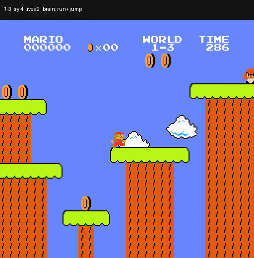

# Super Mario Bros.

A Cadence brain plays World 1 of Super Mario Bros. from the screen. Every 4 frames it sees the
playfield in grey blocks (this decision's and the last one's) and a few readings of Mario's own
body, and picks one of 7 button combinations. In one five-life run it cleared 1-1, 1-2, 1-3 and
1-4 (Bowser) with the same weights, then lost its last two lives in 2-1, a level it never trained
on. It plays frozen; nothing is learned while you watch.

[](docs/mario-gauntlet.mp4)

Runs on `cadence-net==0.95.2` and `nes-py==8.2.1`. The game is not included: you need your own
dump of the cartridge.

By Sean Hall ([cadence-arcade](https://github.com/sean-mcclane832/cadence-arcade), where it was
trained, and its [Mario page](https://sean-mcclane832.github.io/cadence-arcade/mario/)).

## Watch the brain play

[`docs/mario-gauntlet.mp4`](docs/mario-gauntlet.mp4) (1 min 33 s, every NES frame at 60 frames a
second) is the gauntlet: the real start of 1-1 and five lives. A flag moves on to the next level;
a death, or 40 decisions without getting further right, costs a life and restarts that level,
small Mario, a few idle frames later (0, 37, 83, 110, 131), because the emulator is deterministic
and an identical restart replays the identical death. [`evidence/gauntlet.json`](evidence/gauntlet.json)
has every attempt and every button.

| Level | Tries | Result |
| --- | --- | --- |
| 1-1 | 1 | Flag, 311 decisions |
| 1-2 | 1 | Flag, 276 decisions |
| 1-3 | 4 | Deaths at x 747, 1,200 and 1,202, then the flag |
| 1-4 | 1 | Bowser's axe, 189 decisions |
| 2-1 | 2 | Deaths at x 343 and 346: never trained on World 2; game over |

The first tries of 1-1, 1-2 and 1-4 start with 0 idle frames, which is one of the starts it was
trained on; the 1-3 clear starts at 110, which it never trained on. The held-out table below is
the fairer reading.

## Run it

```sh
cd mario
python3 -m venv .venv && .venv/bin/python -m pip install -r requirements.txt
.venv/bin/python -m smb.rom ~/roms          # finds your Super Mario Bros. dump and copies it in
.venv/bin/python play.py                    # the gauntlet in a window, at the game's speed
.venv/bin/python play.py --level 1-3 --idle 110   # one attempt
.venv/bin/python play.py --video run.mp4    # or a video
.venv/bin/python evaluate.py                # the held-out and fresh tables, into evidence/receipt.json
.venv/bin/python -m pytest tests            # no ROM needed
```

`smb.rom` checks every `.nes` file it is given (a file or a folder) and copies the one whose
PRG+CHR SHA-1 (the 16-byte iNES header left out) is `0c4992fc08d2278697339d3b48066e7b5f943598` to
`rom/smb.nes`, which `.gitignore` keeps out of the repository. That is the dump the brain was
raised and measured on (the one gym-super-mario-bros 7.4.0 bundles). Other dumps of the game, such
as No-Intro's "Super Mario Bros. (World)" (PRG+CHR CRC32 D445F698), differ from it in their bytes;
`python -m smb.rom --any <file>` accepts one, but the brain is unchecked there.

nes-py 8.2.1 needs NumPy 1 (`requirements.txt` pins it) and pulls in the old `gym`, which prints a
deprecation notice on import. The window uses tkinter.

## What the brain is

`Brain.compose` with 2,000 inputs, one module of 256 neurons and 7 motor neurons in one slot:
2,519 neurons and 581,120 synapses. Each decision is one `Brain.predict` on that decision's
observation: no recall memory, no working state carried between decisions, and the two-frame
screen is the only view of the past. By this repository's guidance that layout is close to a
control (a window of input, one processing region and a readout), and it is shown here as what
it is: the brain that got furthest in this game so far. See the [model card](MODEL_CARD.md).

- **Eyes (1,664).** The playfield below the score bar in grey, 8 x 8 px blocks (26 x 32), as
  distance from the frame's most common grey, for this decision and the last.
- **Body (336).** 42 readings, 8 copies: from RAM, Mario's x and y speed, on ground or in the air,
  still rising, facing, small/big/fire, hurt and star timers, time left; and the 4 buttons held
  during the last decision. No enemy, tile or pit is read from RAM.
- **Buttons.** None, right, right+jump, run, run+jump, jump, left; held for 4 frames.

## How it was trained

Imitation of a coach, with DAgger. The coach is not a learner: at every decision it saves the
emulator, tries a fixed menu of short button plans (run, jumps of several lengths, wait, back off)
16 decisions ahead, and labels the first button of the plan that ends furthest right without
dying. It reads Mario's x and the death flag from RAM to score its plans; the brain never sees
them. The brain plays greedily, the coach labels the screens the brain's own play reaches, and
batches of 32 labelled screens are taught through the brain's learner with memory off. Training
ran on cadence-net 0.91.1 to 0.91.3 from late October to 1 November 2026: 1-1 and 1-2 first,
then all four World 1 levels with lesson shares weighted to 1-3. The model card has the lineage.

The training code lives in [cadence-arcade](https://github.com/sean-mcclane832/cadence-arcade/tree/main/mario).
It runs on gym-super-mario-bros, whose licence is not an open one, so it is not part of this
folder. `smb/console.py` reproduces that package's single-level start and frame handling on
nes-py, and on the training dump it gives the brain the same screens, RAM and answers at every
decision of the gauntlet and of the 200 held-out attempts (32,402 decisions).

## Results

Brain alone, frozen and greedy, one attempt per start, small Mario, the level's start after N idle
frames, stuck limit 40 decisions, cap 900 ([`evidence/receipt.json`](evidence/receipt.json)).

| Level | Held-out starts (50, the ones it was picked on) | Fresh starts 140-189 (50, read once) |
| --- | --- | --- |
| 1-1 | 7 (40 more stand still) | 11 (27 more stand still) |
| 1-2 | 8 | 1 |
| 1-3 | 9 | 15 |
| 1-4 | 27 | 34 |

Every attempt that does not reach the flag ends in a death, except on 1-1, where most end with
Mario standing still for 40 decisions (2.7 s of game time). None of the four levels is
consistent: 1-4 on about two starts in three, 1-2 on 1 fresh start of 50 (its 8 held-out
clears were partly the luck of the pick).
Other checkpoints of the same run are stronger on single levels (one clears 1-1 on all 50
held-out starts), and none is at least as good on all four.

## Next

A second brain, Fabius, is training now on cadence-net 0.95: a recall memory, a colour eye
around Mario, and output neurons that predict what the next frames bring. It is coached on
worlds 1 to 7; World 8 is kept as an exam it is never coached on.
