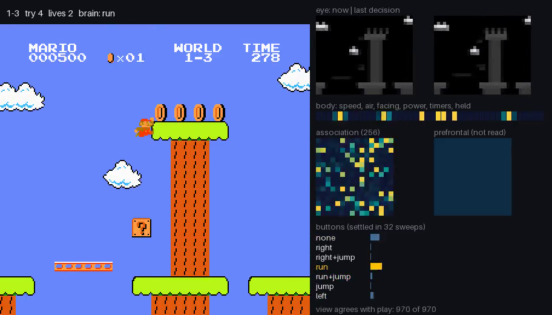

# Super Mario Bros.

A Cadence brain plays World 1 of Super Mario Bros. from the screen. Every 4 frames it sees the
playfield in grey blocks (this decision's and the last one's) and a few readings of Mario's own
body, settles, and presses one of 7 button combinations. In one five-life run it cleared 1-1,
1-2, 1-3 and 1-4 (Bowser's castle) with the same weights, then lost its last two lives in 2-1, a
level it never trained on. The window shows the game beside the brain view: what the eye gets,
the body readings, the settled neurons and the button neurons. The brain plays frozen; nothing is
learned while you watch.



Runs on `cadence-net==0.95.2` and `nes-py==8.2.1`. The game is not included: you need your own
dump of the cartridge.

By Sean Hall. Trained in [cadence-arcade](https://github.com/sean-mcclane832/cadence-arcade),
which has the full history and a [Mario page](https://sean-mcclane832.github.io/cadence-arcade/mario/).

## Watch it play

[`docs/mario-gauntlet.mp4`](docs/mario-gauntlet.mp4) (1 min 33 s, 912 x 520) is the whole
five-life run with the brain view, every frame the brain plays at 60 frames a second; idle
starts, deaths, pipes and flagpole slides are skipped, as in training.
[`docs/mario-1-3.webm`](docs/mario-1-3.webm) is 15 s of it: the fourth try at 1-3, across the
treetops to the flag. [`evidence/gauntlet.json`](evidence/gauntlet.json) has every attempt and
every button.

The run's rules: the real start of 1-1 and five lives. A flag moves on to the next level. A death,
or 40 decisions (2.7 s of game time) without getting further right, costs a life and restarts that
level with small Mario a few idle frames later (tries 1 to 5 start after 0, 37, 83, 110 and 131),
because the emulator is deterministic and an identical restart replays the identical death.

| Level | Tries | What happened |
| --- | --- | --- |
| 1-1 | 1 | The flag, 311 decisions |
| 1-2 | 1 | Underground, out through the exit pipe, the flag; 276 decisions |
| 1-3 | 4 | Deaths at x 747, 1,200 and 1,202, then across to the flag (261 decisions) |
| 1-4 | 1 | Through the castle to Bowser's axe, 189 decisions |
| 2-1 | 2 | Deaths at x 343 and 346; never trained on World 2; game over |

The first tries of 1-1, 1-2 and 1-4 start with 0 idle frames, one of the starts the brain was
trained on; the 1-3 retries (37, 83, 110) are held-out starts it was picked on. The brain is also
packed because of this run: six checkpoints of its training run played it, and this is the only
one that got past 1-1. The fresh starts under [Readings](#readings) are the fairest measure.

## Run it

```sh
cd mario
python3 -m venv .venv && .venv/bin/python -m pip install -r requirements.txt
.venv/bin/python -m smb.rom ~/roms          # finds your Super Mario Bros. dump and copies it in
.venv/bin/python play.py                    # the five-life run in a window, with the brain view
.venv/bin/python play.py --level 1-3 --idle 110   # one attempt
.venv/bin/python play.py --video run.mp4    # or a video file
.venv/bin/python evaluate.py                # the readings, into evidence/receipt.json
```

`smb.rom` checks every `.nes` file it is given (a file or a folder) and copies the one whose
PRG+CHR SHA-1 (the 16-byte iNES header left out) is `0c4992fc08d2278697339d3b48066e7b5f943598` to
`rom/smb.nes`, which `.gitignore` keeps out of the repository. That is the dump the brain was
raised and measured on (the one gym-super-mario-bros 7.4.0 bundles). Other dumps of the game, such
as No-Intro's "Super Mario Bros. (World)" (PRG+CHR CRC32 D445F698), differ from it in their bytes;
`python -m smb.rom --any <file>` accepts one, but the brain is unchecked there.

The window runs at the game's speed (`--speed 2` or `4` for faster, `0` for as fast as the brain
answers; `--no-view` for the game alone). Over the five-life run a decision took 2.1 ms on an
i7-9700K and the brain view 8.7 ms more, with four training runs busy in the background
([`evidence/gauntlet.json`](evidence/gauntlet.json)); a decision lasts 67 ms at the game's speed. nes-py 8.2.1 needs
NumPy 1 (`requirements.txt` pins it) and pulls in the old `gym`, which prints a deprecation notice
on import. The window uses tkinter.

## The brain view

Every decision the brain answers with `Brain.predict`. For the view, the same observation is
settled a second time inside `cadence.recording.record_settlements`, which records every neuron at
every sweep; the played answer never comes from the recording (the recorder runs the library's
NumPy path, which can differ at round-off). The view counts how often its answer agrees with the
played one: 100%, 1,394 of 1,394 decisions over the five-life run on cadence-net 0.95.2
([`evidence/gauntlet.json`](evidence/gauntlet.json)).

- **Eye**: the two grey maps the brain gets, this decision and the last, 26 x 32 blocks each.
- **Body**: the 42 body readings below, one copy.
- **Association**: the 256 neurons of the brain's one module after the settle, warm for active.
- **Prefrontal**: the composed working-memory region; `predict` does not read it, so it stays dark.
- **Buttons**: the 7 motor neurons at the end of the settle on their real scale (-0.1 to 1), the
  pressed one marked, and the settle's sweep count (32 on every decision of the run, same file).

## The brain

```python
brain = Brain.compose(2000, 7, modules=(256,), seed=0, teaching="normalized", learning_surprise=False)
brain.learner.config = dataclasses.replace(brain.learner.config, eta=0.001, eta_bias=0.0001)
```

One module of 256 neurons between 2,000 inputs and 7 motor neurons in one slot: 2,519 neurons
(sensory 2,000, association 256, prefrontal 256, motor 7) and 581,120 synapses (`describe()` on
the shipped file, which reports the teaching as "custom" after the step change).

- **Acts.** Each decision `Brain.predict(x)` settles the brain on that decision's observation; the
  strongest motor neuron is the button combination, held for 4 frames (15 decisions a second at
  the game's speed).
- **Memories.** Synapses: written by lessons in training, frozen here. Nothing else is carried from
  one decision to the next: `predict` reads no working memory or recall, so the two-frame eye and
  the held buttons in the input are the brain's only view of the past. On 32 recorded observations
  the answers are the same in forward and in reversed order (`tests/test_brain.py`).

By this repository's guidance that layout is close to a control: a window of input, one processing
region and a readout. It is shown here as what it is: a small screen brain that cleared all of
World 1 in one greedy five-life run. The [model card](MODEL_CARD.md) declares each memory.

## What the brain sees

2,000 numbers per decision ([`smb/eye.py`](smb/eye.py)):

| Slice | Count | Content |
| --- | --- | --- |
| eye, this decision | 832 | the playfield below the score bar in grey, 8 x 8 px blocks (26 x 32), as distance from the frame's most common grey (the sky above ground, black underground and in castles) |
| eye, last decision | 832 | the same, one decision ago |
| body, 8 copies | 8 x 38 | from RAM: x speed (9 population codes), y speed (9), float state (ground, jumping, falling, pole), still rising, facing (2), power (small, big, fire), hurt and star timers, time left (8) |
| held buttons, 8 copies | 8 x 4 | A, B, right and left during the last decision |

No enemy, tile or pit position is read from RAM: the world comes from the eye. The held buttons
are there because Super Mario Bros. jumps on the press of A: holding A from the last decision makes
a new jump do nothing, and a screen-only brain cannot tell whether A is already down.

The buttons: none, right, right+jump, run, run+jump, jump, left (run is right with B).

## How it learned

Imitation of a coach, then DAgger. The coach is not a learner: at every decision it saves the
emulator, plays out a fixed menu of short button plans 16 decisions ahead (run, run-jumps of
several lengths, wait, back off, short hops) and labels the first button of the plan that ends
furthest right without dying. It scores its plans by Mario's x and the death flag in RAM; the brain
never sees those.

1. **Piles.** Coach labels on the screens of coach games and of the brains' own games, per level.
   For the last stage of training: 1-1 32,904 rows, 1-2 66,001, 1-3 34,411, 1-4 26,530 (the run's
   log). A row is critical when every other first button would end more than 50 px behind (in
   practice, a death); the trainer draws critical rows more often.
2. **Lessons.** Batches of 32 rows, drawn across the levels by share, go through the brain's
   learner with memory off (`brain.learner.step(brain.stimulus(x, memory=False), labels)`), 250
   batches a chunk. Each chunk's checkpoint plays the selection starts.
3. **Its own path (DAgger).** Every few chunks the brain plays greedily, from a level's start and
   from points along the coach's own path, and the coach labels every screen it reaches: the
   lessons come from where the brain actually goes, its mistakes included.
4. **The line.** Earlier brains of the line learned 1-1 and then 1-2 (the 1-2 brain clears it on 29
   of 50 held-out starts); three hours of 1-2 DAgger followed; then a run on all four World 1 levels
   (shares 1-1 0.20, 1-2 0.30, 1-3 0.25, 1-4 0.25, DAgger on 1-3 and 1-4), whose checkpoint 30 cleared
   1-1, 1-2 and 1-4 but never 1-3; then the last run, from that checkpoint, weighted to 1-3 (shares
   0.15, 0.25, 0.40, 0.20, a DAgger round on 1-3 every 8 chunks). Its checkpoint 35, 77 minutes in
   on 4 worker processes, is packed. All of it on cadence-net 0.91.1 to 0.91.3, late October to
   1 November 2026.

## Readings

Brain alone, frozen and greedy, one attempt per start, small Mario at the level's start after N
idle frames (the emulator is deterministic; the idle frames move the enemies), stuck limit 40
decisions, cap 900 ([`evaluate.py`](evaluate.py); [`evidence/receipt.json`](evidence/receipt.json)).
Training drew starts 0 to 79 except 32 to 41. Held-out: 50 starts (32 to 41, 80 to 99, even 100 to
138), never trained on, but the brain was picked on them. Fresh: starts 140 to 189, read once for
this release.

| Level | Held-out flags (picked on) | Fresh flags (read once) |
| --- | --- | --- |
| 1-1 | 7 of 50 (40 more stand still) | 11 of 50 (27 more stand still) |
| 1-2 | 8 of 50 | 1 of 50 |
| 1-3 | 9 of 50 | 15 of 50 |
| 1-4 | 27 of 50 | 34 of 50 |

Every attempt that does not reach the flag ends in a death, except on 1-1, where most end with
Mario standing still for 40 decisions. 1-2 drops from 8 held-out clears to 1 fresh one: its
held-out number was partly the luck of the pick. Of the eight other checkpoints of the same run
scored on the held-out starts (cadence-arcade `mario/concepts/runs/p4/held_F2ck*.json`), some are
stronger on single levels (one clears 1-1 on all 50), and none is at least as good on all four.

## Limits

- **World 1 only.** It has never trained on another world: in 2-1 it got no further than x 722 on
  50 starts.
- **Not consistent.** 1-4 is the strongest level (27 and 34 of 50); 1-2 is cleared on 1 fresh start
  of 50. On 1-1 it mostly stops and stands still.
- **Imitation, not reward.** The brain learned from a coach's labels. The coach picks them by
  outcome (how far right, alive), but the brain never sees the score or an outcome, and nothing is
  learned while you watch.
- **RAM in the body readings.** Mario's speeds, float state, facing, power, timers and the level
  timer come from RAM; the world is pixels.
- **A short memory.** The only past the brain sees is the last decision's screen and buttons.
- **One dump.** Raised and checked on one dump of the cartridge on nes-py; other dumps are
  unchecked.

## Train your own

The coach, the piles, the trainer and the evaluation are in
[cadence-arcade/mario](https://github.com/sean-mcclane832/cadence-arcade/tree/main/mario)
(`game.py` for the coach, `dagger.py`, `concepts/csteady.py`, `concepts/cplay.py`), with the run
logs and notes. They run on gym-super-mario-bros (Christian Kauten), so they stay there.
[`smb/console.py`](smb/console.py) follows that package's single-level start and frame handling
step by step, rewritten on nes-py: on the training dump it gives this brain the same screens, RAM
and answers at every decision of the five-life run and of the 200 held-out attempts (209 attempts,
32,402 decisions, [`evidence/parity.json`](evidence/parity.json)), so this brain plays here as it
played there.

## Layout

| Path | What |
| --- | --- |
| `play.py` | the window or a video: the five-life run or one attempt, with the brain view |
| `evaluate.py` | the readings, into `evidence/receipt.json` |
| `smb/` | the console on nes-py (`console.py`), the eye and the body (`eye.py`), the player (`player.py`), the brain view (`view.py`), the ROM import (`rom.py`) |
| `brain/brain.npz` | the brain |
| `evidence/` | the receipt of the readings (every attempt), the five-life run's log with the brain view's checks and timings, the parity of this console with the training stack |
| `docs/` | the screenshot, the full run and the 1-3 clip |
| `tests/` | the brain loads and answers as it played, the eye's layout and the start sets, without a ROM |

```sh
.venv/bin/python -m pip install pytest && .venv/bin/python -m pytest tests -q
```

## Next

A second brain, Fabius, is training now on cadence-net 0.95: a recall memory, a colour eye around
Mario, and output neurons that predict what the next frames bring. It is coached on worlds 1 to 7;
World 8 is kept as an exam it is never coached on.

## Licence

GPL-3.0, as Cadence ([`LICENSE`](LICENSE)). The game and its ROM are Nintendo's and are not
distributed here.
