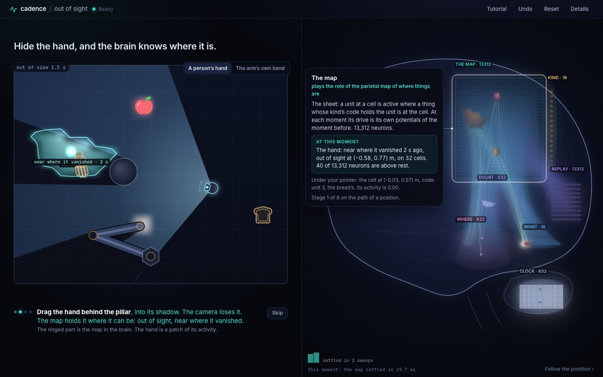
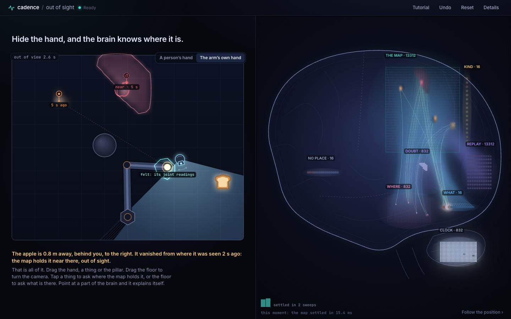
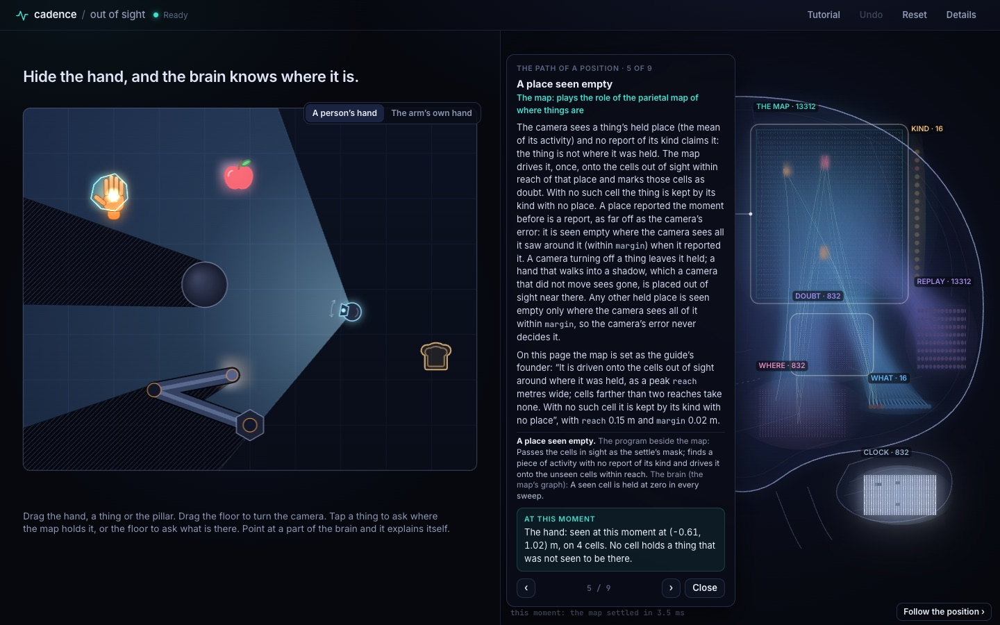

# Out of sight

Hide the hand, and the brain knows where it is.

A room seen from above: a robot arm, a hand, an apple and a slice of bread, and a body that
carries a camera, whose view a pillar and the arm cut into light and shadow. A Cadence brain
holds a map of what is where, in its own activity. A thing enters the map at the moment the
camera first sees it. Drag the hand behind the pillar, and the map holds it out of sight, near
where it vanished; turn away from the apple, and the apple stays on the map, behind you. The page
is one screen: the scene on the left, with what the map holds drawn on it, and on the right the
whole brain, every neuron and every synapse, laid out as a brain seen from the side. The scene
and the brain run in the browser. There is no server.

This is the demonstration page of
[cadence#320](https://github.com/muellerberndt/cadence/issues/320), spatial object awareness:
a map that holds where things are while they are out of view.

> **Status: under construction on the branch `space`.** The page runs the what-where map
> (`cadence.space.map.Map`) from a development wheel built from the library's branch
> lane-099-space at 824c9ae9, and a development map file of the founder's settings
> ([model card](MODEL_CARD.md)). Both sit on this branch only, named as development files in
> `site/pack/manifest.json`; before any pull request they are replaced by the released wheel
> and the map the library ships. The headline is provisional (one constant, `PROMISE` in
> `site/app.js`).
>
> **The model.** By the owner's ruling of 12 November 2026
> ([cadence#320](https://github.com/muellerberndt/cadence/issues/320), "The model"), the map is
> the brain's own state. It is carried activity and wiring: its graph has no taught synapse. A
> thing enters the map when a sense first reports it; sensory information updates its place;
> with no sensory information the last known place stays in the state. A thing whose place the
> camera sees empty is held on the cells out of sight near where it was last seen, and as "not
> known where" where no unseen cell lies within reach. Nothing on the page moves an unseen thing
> by a model of movement. The second stage, learned physics on the map, follows in a later
> release.
>
> **The earlier models are not on the page.** The plain composed brain and the place module of a
> program beside the brain, which the page ran before the ruling, are removed with their hosts
> and their checks; their readings are in this branch's history (a8b35eb).

## Readings on the page

The promise, replayed on the page from the two scene files of the tracking chamber (a hand goes
behind the pillar at 0.5 m/s, rests there for 70 moments and comes back; 323 moments, 91 of them
with the hand out of view), as `tools/check_page.py` reads it (`evidence/page_check-20261113-0039-75f4dddb.json`,
2026-11-13 00:37, on the wheel of 824c9ae9; the three runs on that wheel read the same):

| Scene file | In view | Hidden, mean | Last seen, hidden | Kalman filter, hidden | The hand's cells hold it | Its cells, mean | Back in view | A moment |
| --- | --- | --- | --- | --- | --- | --- | --- | --- |
| the arm folded (`promise-scene.json`) | 1.2 cm | 10.7 cm | 15.5 cm | 27.8 cm | 1.00 | 39 | 1.0 cm | 19 ms |
| the arm's shadow joined to the pillar's (`promise-merged-shadows-scene.json`) | 1.2 cm | 10.7 cm | 15.5 cm | 27.8 cm | 1.00 | 39 | 1.0 cm | 14 ms |

The map holds the hand near where it vanished on every hidden moment, and its cells hold the
true hand on every hidden moment of both files. The page's readings are the model's own on the
same files: `tests/test_map_host.py` drives the host natively on the pack's wheel and map file and
reads the same inventory as `Map` driven directly. The map holds no randomness: replays read
alike to the digit (`tools/promise_runs.py`; `evidence/promise_runs-20261113-0041-75f4dddb.json`, on the wheel of 824c9ae9).

The arm's own hand, out of the camera's view and moved by the arm, in the tutorial's last step:
0.6 mm from the hand on average over 64 hidden moments, 1.3 mm at worst (bound 1.5 cm).

A frame took 16.7 ms at the median and 16.7 ms at the 95th percentile with the
brain view and its bloom on (bounds 20 ms and 34 ms); a moment of the map, with its inventory and
every neuron's activity for the brain view, took 16.9 ms of the scene's 33 ms at the median. These
were read with the Mac's load average at 50 to 77 from other work: upper bounds.



## What a visitor does

- **Drag the hand** behind the pillar and back.
- **Drag the floor** around the body to turn the camera, or twist with two fingers. Things leave
  its view and end up beside or behind the body.
- **Tap a thing** to ask the map where it is; **tap the floor** to ask what is there. Each answer
  is a settle of the map with the question as its cue, and one sentence under the scene.
- **Tap the body** to switch the camera off.
- **Switch the hand** (over the scene's corner): a person's hand, or the arm's own hand. Tap the
  floor and the arm reaches there.
- **Undo** and **Reset**. Reset empties the map: it holds no thing until the camera sees one.

A tutorial of four steps, which the visitor performs, opens on the first visit: hide the hand;
bring it back; turn away from the apple (the bread enters the map when the camera first sees
it); the arm's own hand, out of the camera's view, placed by its joint readings.

While the hand is hidden, its true place shows as an outline, with a dashed line to where the
map holds it and the distance between the two.

## Two hands

- **The arm's own hand.** The page works the hand's place out from the arm's joint readings
  (forward kinematics, a program's step) and gives the map that place at every moment as what
  the body's own sense reports (`felt`). Out of view the map holds the hand where its readings
  name it.
- **A person's hand.** Nothing reports it out of view. The map holds it on the cells out of sight
  near where it vanished: "it is not where I saw it, so it is where I cannot see, near there".
  The area those cells cover is drawn as the hand's light.

The comparison with the last seen place and a constant-velocity Kalman filter, given the same
camera reports, is in Details.



## The brain explains itself

Nothing is written over the brain until the visitor points at something. Every part (a region
or a fibre tract) opens a card on hover, on a tap and on keyboard focus. The card stands beside
its part, never over it, with a thin line to it; on a phone it is a sheet from the bottom, and
the brain moves up above it. It holds the part's name, the role it plays, what the region holds
in the words of the library's guide, and what it is doing at this moment.

**Follow the position** steps through the guide's nine steps of "How a position travels", word
for word, each with its parts ringed, the rows of the guide's table "What the brain does and what
the program does" that belong to it, and its live numbers. The texts are in `site/cards.js`,
taken from `docs/space.md` of the commit the wheel is built from.



| Region of the map's graph | Neurons | Drawn as | Plays the role of |
| --- | --- | --- | --- |
| `map` | 13,312 | the map itself: 32 by 26 cells as the room's, each cell's 16 code units in a small square, a unit lit in the colour of the kind it codes | the parietal map of where things are |
| `held` | 13,312 | the same sheet, smaller: lit while a question by kind is asked | recall: the map replayed for a question |
| `reference` | 16 | a column of units | attention to one kind |
| `where` | 832 | one a cell | place cells: where a kind is |
| `what` | 16 | one a code unit | object cells: what a thing is |
| `clock` | 832 | one a cell, where the cerebellum sits | a timer |
| `doubt` | 832 | one a cell | a confidence estimate: the cells of doubt |
| `lost` | 16 | one a code unit | knowing a thing with no place |

The roles are the page's reading of each region; the regions and what they hold are the map's
own. Everything drawn is the map's state at that moment:

- A neuron is lit by its activity above rest, relative to the most active neuron of its region
  (the map's activities are small: a report writes a length of 0.02).
- The `map` region is also drawn as an image of itself: each cell's code units summed in the
  colours of their kinds, as soft light under its neurons.
- A synapse glows with the signal it carries, `|weight x presynaptic activation|`, against its
  tract's strongest synapse and its source region's most active neuron, with a faint light of
  the weight alone, turned down where many synapses overlap. 39,936 synapses, every one drawn,
  none taught.
- The settle plays as a wave from the map's own record by sweep (`Map(trace=True)`): the inputs,
  then the sheet settled, then `where` and `what` settled on it. A question plays its own settle.
- The regions that record keeps (`map`, `where`, `what`) are drawn sweep by sweep; the others
  (`held`, `reference`, `clock`, `doubt`, `lost`) as they settled, from every neuron's settled
  potential.

## What follows

The map moves nothing it does not sense. The second stage, learned physics on the map, follows in a
later release.

## Details

One switch, off until asked for, holds the chart of the hand's distance from the map's place,
the last seen place and the Kalman filter (ports of the tracking chamber's controls, with their
markers on the scene), the milliseconds of a moment, the hand's cells, and **Load a scene**,
which replays a scene file of the tracking chamber (`cadence-tracking-scene/1`, also by dropping
the file on the page). A replay empties the map and gives it exactly the file's reports, with
the page's rule for which cells the camera sees.

## Run it locally

```sh
python3 -m http.server 8840 --directory site   # from out-of-sight/; then open http://127.0.0.1:8840/
```

The first visit downloads Pyodide and NumPy from jsDelivr (about 10 MB) and the page's own
files (under 1 MB). `?tour=1` starts the tutorial and `?tour=0` skips it, `?renderer=2d` draws
the brain with Canvas2D, `?wave=0` turns the sweep-by-sweep replay off and `?details=1` opens
the details.

## Files

| Path | What |
| --- | --- |
| `site/index.html`, `site/styles.css`, `site/favicon.svg` | the page |
| `site/app.js` | the loop, dragging and tapping, the questions, undo and reset, the tutorial, the cards, scene files |
| `site/world.js` | the scene's geometry, the camera's view, the step and the scene file reader: a port of the tracking chamber's world |
| `site/controls.js` | the last seen position and the Kalman filter: a port of the chamber's controls |
| `site/where.js` | plain words for where a thing is around the body, and the two answers' sentences |
| `site/scene.js` | the scene, with what the map holds drawn on it, and the chart |
| `site/brain.js` | the brain view (WebGL2, with a Canvas2D fallback) and its self-explaining parts |
| `site/cards.js` | what every part says about itself, and the nine steps of a position's path, in the guide's words |
| `site/region.js` | a thing's cells as soft light and their edge |
| `site/worker.js` | Pyodide, the Cadence wheel, the map file and the host, checked against `pack/manifest.json`; the cells the camera sees at each moment |
| `site/pack/` | the wheel, the map file (`map/`), the host (`py/spacebrain/map_host.py`), `manifest.json` with SHA-256 |
| `tools/build.py` | builds `site/pack/` from a wheel and a map file |
| `tools/check_page.py` | the page, end to end, in headless Chromium; writes `evidence/page_check-<date>-<time>-<wheel>.json`, a file a run |
| `tools/check_logged.py` | the page check with the map's apple logged moment by moment, and each change of its state |
| `tools/promise_runs.py` | the two scene files replayed on the page, three times each; writes `evidence/promise_runs-<date>-<time>-<wheel>.json` |
| `tools/export_promise.mjs` | the two scene files of the promise, as the stage they were recorded on gives them |
| `tools/record_scenes.py`, `tools/record_clip.py` | the parity fixtures from the Python world; a clip of the tutorial |
| `MODEL_CARD.md` | the map the page runs |
| `tests/test_map_host.py` | the host run natively on the pack's own wheel and map file: the same inventory as the map driven directly on both scene files, nothing announced, a sound and the joint readings, questions both ways, an emptied map, the wave |
| `tests/lit_cells.mjs` | which of the map's cells the camera sees at each step of a scene file, by the page's rule |
| `tests/parity.mjs`, `tests/fixtures/` | the parity test of `site/world.js` and `site/controls.js` against the chamber's Python, and the scene files |
| `tests/region.mjs` | an area given as cells, on sheets made in the test |

## Checks

```sh
node tests/parity.mjs                      # the page's world and controls against the Python ones
node tests/region.mjs                      # an area given as a set of cells
python -m pytest tests/test_map_host.py    # the host natively, on the pack's wheel and map file
python tools/check_page.py --shots shots   # the page, with the mouse a visitor uses
python tools/check_logged.py --log apple.json --shots shots   # the same, the map's apple logged
python tools/promise_runs.py               # the two scene files, three runs each
```

**The page check** (`tools/check_page.py`), run through `tools/check_logged.py`, which records the
map's apple moment by moment. On the wheel of 824c9ae9 three runs read 47 of 47
(`evidence/page_check-20261113-0033-75f4dddb.json`, `-0036-`, `-0039-`), a fourth after the
labels on the table were drawn over the whole scene, 47 of 47 (`-0045-`), and a fifth after the
learned-physics view left the page, 47 of 47 (`-0058-`). Its bounds were set
before the page ran the map, from the gates of
[cadence#320](https://github.com/muellerberndt/cadence/issues/320), from last seen on the same
rows and from the owner's word on the arm's own hand; the model's native readings on the two
scene files were known when they were set, the page's were not. The file states every bound, how
it was set and its two recorded changes, neither a bound: where "what is there" is asked (made
before the page first ran the map), and the number of the guide's steps (eight before 824c9ae9,
nine from it). The earlier models' checks left the page with their hosts.

In each of the three runs the logger shows the apple held where it was last seen through the
tutorial's turn, the camera's heading moving at most 0.12 rad between moments; and the apple
moved unseen held near its old place on 28 to 31 cells once the camera saw that place empty,
shrinking to none as the field turned over them, read "not known where", and found again as one
apple. On the earlier wheels the checks on the apple failed in some runs (the history of this
branch and `evidence/`: 45 of 47 on 38820655; 47 and 45 on fac45529; 45, 45, 45, 46 and 47 on
a155d0dc), each for a term of the map's sight the next wheel changed. No check was amended for
it.

Cadence is GPL-3.0.
