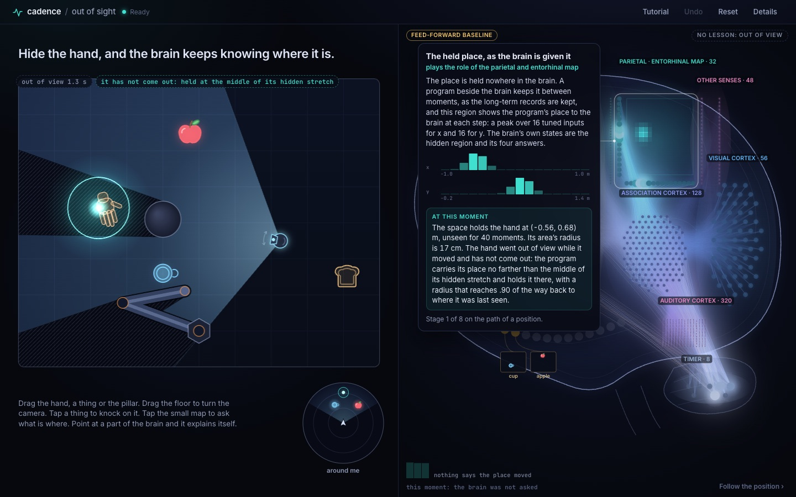
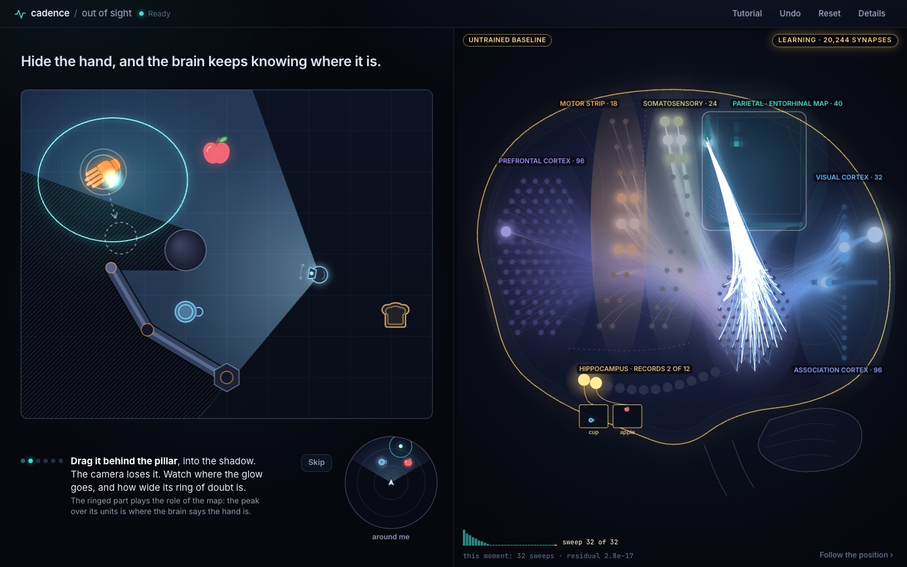
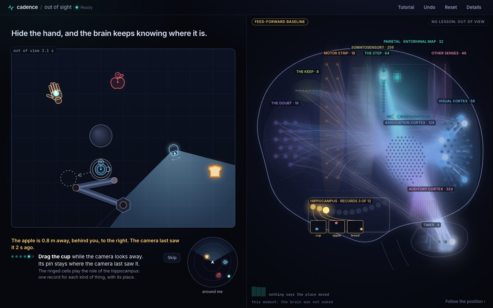

# Out of sight

Hide the hand behind the blind spot, and the brain keeps knowing where it is.

A room seen from above: a robot arm, a hand, a cup, an apple and a slice of bread, and a body
that carries a camera, whose view a pillar and the arm cut into light and shadow. A Cadence
brain is asked at every moment where the hand is, in view and out of view, and it keeps a record
of what is where: turn the camera away from the apple, and the apple is behind you on its map.
The page is one screen: the scene on the left, with the brain's answer drawn on it (a glowing
peak inside the area the brain says holds the hand nine times in ten, and a pin for every thing
it remembers), and on the right the whole brain, every neuron and every synapse, laid out as a
brain seen from the side. The scene and the brain run in the browser. There is no server.

This is the demonstration page of
[cadence#320](https://github.com/muellerberndt/cadence/issues/320), spatial object awareness:
a map that holds where things are while they are out of view.

> **Status: under construction on the branch `space`.** The page runs the place module's
> **development file, a feed-forward baseline** ([model card](MODEL_CARD.md)), with a wheel
> built from the library's branch that holds `cadence.space` and `cadence.modules`. A program
> beside the brain holds each place; the brain answers how far a place moves in a step, how far
> off it may be, and the place a cue names. The page check below reads 40 of 42: in view and
> after the return the place lies within a centimetre of the hand. Hidden behind the pillar,
> where the hand stops, it lies 33 cm away on average (bound 10 cm): the promise is not kept by
> this file. A version that settles takes this file's seat
> through `site/pack/manifest.json`. The plain composed brain the page was built on stays as a
> second host (`tools/build.py` without `--module`).
>
> The development module file and the branch-built wheel sit on this branch only, named as
> such. They do not reach `main`: before any pull request they are replaced by the released
> wheel and the module the library ships.



## What a visitor does

Everything is direct: there is no panel of switches.

- **Drag the hand** with the mouse or a finger, into the pillar's shadow and out of it.
- **Drag the pillar**, and the shadow moves with it.
- **Turn the camera**: drag the floor around the body, or twist with two fingers. Things leave
  its view and end up beside or behind the body. **Tap the body** to switch the camera off:
  nothing is in view.
- **Drag a thing** (the cup, the apple, the bread) while the camera cannot see it: its pin stays
  at the place it was last seen.
- **Tap a thing** to knock on it: the ear hears the direction and the distance of the sound, and
  the record moves without sight. A dashed pin came from a sound.
- **The small map** under the scene shows the records as the body has them: the body at the
  centre, facing up, each thing at its direction and distance inside a soft ring. **Tap a thing
  in it** to ask where it is; **tap an empty direction** to ask what is there. The answer is one
  sentence under the scene ("The apple is 0.8 m away, behind you, to the right. The camera last
  saw it 2 s ago."). Its label switches it between "around me" and the room.
- **Undo** takes the last move or turn back; **Reset** puts everything where it stood.

A tutorial of six steps, which the visitor performs, opens on the first visit: follow, hide,
return, turn the camera away from the apple, move the cup while the camera looks away, knock.
It can be skipped and played again.





Keys, with the scene in focus: `1` to `5` choose the hand, the cup, the apple, the bread or the
pillar; the arrows move it; `K` knocks on it; `Q` and `E` turn the camera; `C` switches it; `H`
shows or hides what the camera cannot see; `Z` is undo and `R` reset. With the small map in
focus, the arrows ask what is in front, behind, left and right, and `1` to `4` ask where a thing
is. In the brain, `Tab` moves from part to part.

## The brain explains itself

Nothing is written over the brain until the visitor points at something. Every part (a
population, the records, a fibre tract) opens a card on hover, on a tap and on keyboard focus.
The card stands beside its part, never over it, with a thin line to it; on a phone it is a sheet
from the bottom, and the brain moves up above it. It holds
its name, the role it plays, what it does in one or two plain sentences, and what it is doing at
this moment, written from the brain's live state ("It says the hand is at (-0.17, 0.71) m,
unseen for 25 moments. Uncertainty 99 cm, up from 92 cm when the hand was last seen."). Cards of
population codes draw the peak over their tuned units as it stands.

**Follow the position** steps through the path of a position in eight stages, each with its
part ringed and its live numbers: what the camera reports; how a position becomes activity; the
place and what holds it; how it moves while unseen; how sight corrects it; doubt; what is where,
around the body; the answer. The texts are in `site/cards.js`, keyed by the brain's kind: they describe
the baseline brain, and the three stages the trained place module does another way say so on
their cards. The text on how a kind and a place are bound, and on what the body's own turn does
to a held place, is marked provisional on its cards until the trained module's description
replaces it.

Every population sits in the region whose role it plays. The page names the role; it claims
nothing about what the neurons are.

| Region of the place brain | What it holds | Plays the role of |
| --- | --- | --- |
| `place`, 32 | the program's place for the thing, shown to the brain: a peak on each axis | parietal and entorhinal map |
| `moved`, 18 | the copy of the arm's command | motor strip and the copy of its commands |
| `motion`, 56 | the thing's last seen movement | visual cortex |
| `unseen`, 8 | the moments since it was seen | a timer, drawn where the cerebellum sits |
| `heard`, 320 | a cue: its direction and distance | auditory cortex |
| `felt`, 256 | the arm's joint readings | somatosensory strip |
| `hidden`, 128 | between the inputs and the answers | association cortex |
| `shift`, 64 | answer: how far the place moves in this step | path integration |
| `spread`, 16 | answer: how far off the place may be | a confidence estimate |
| `found`, 48 | answer: the place a cue or a posture names | the map's entry from the other senses |
| the places of things, one row a thing, and the records of things at rest | kept by the program beside the brain | hippocampus |

The roles are the page's reading of each region. The regions and what they hold are the
module's own.

- A synapse glows with the signal it carries, `|weight x presynaptic activation|`, in its source
  population's hue, warmer where it excites and cooler where it inhibits; all 24,096 are drawn,
  bundled into tracts between regions, with a faint light of the weight alone so the wiring
  shows at rest. The light blooms (the same light, blurred and added back) and is tone mapped.
- The settle plays as a wave: the worker settles the brain again from the state the moment
  started from, under the same drive, for exactly the sweeps the answer took, and sends up to 12
  of them; the host checks that the last sweep is the state the answer was read from and sends
  nothing otherwise. The page shows one sweep every 70 ms: a pulse runs along each synapse whose
  neuron changed in that sweep, a ring lights each region its change reaches, and the trace
  beside the readout shows the largest change of every sweep, with the sweep on show lit. A new
  wave starts when the one on show has played.
- The view drifts a few pixels, slowly, and its layers part (the outline behind, the neurons in
  front). With reduced motion asked for, it rests and the settle is shown as its final state.
- A lesson's changed synapses flash, gold where they grew and blue where they shrank, and the
  outline glows. Lessons happen only at moments the camera sees the hand.
- A record's cell lights when the record is read or written; its thumbnail shows the place it
  holds.
- A settle that finds no qualified state gives no answer; the page counts it (Details, "No
  answer").

## Display constants

Everything drawn of the brain is its state at that moment. A few constants set how that state
becomes light; they change no number the brain holds (`site/brain.js`):

- `SIGNAL` (0.062): how bright a synapse's signal `|weight x presynaptic activation|` is drawn.
  Each tract is read against its own mean weight, a tract of many synapses glows fainter per
  synapse, and a brain drawn small or of many synapses is turned down with its size and their
  number.
- `DENSE`: the tracts that leave the association region are drawn at 0.42 of that gain, and
  those that leave the working trace at 0.8. Most of those neurons are active at once, and at
  the full gain their light covers every other tract.
- `ANATOMY_LIGHT` (0.1): the wiring's faint light at rest, from the weight alone.
- A region's neurons are drawn relative to the most active neuron of that region, on a scale
  that eases down and jumps up; a card reads the raw activation.
- `BLOOM` (0.8), the view's drift (5 and 3 pixels, 0.7% of zoom) and the wave's 70 ms a sweep,
  with its pulses drawn relative to the settle's largest change.
- The ring on a thing in the small map is the error of what wrote its record (the camera's
  1 cm, or a cue's own error at the distance heard). The ring on the hand is the spread of the
  brain's own answer.

## Details

One switch, off until asked for, holds the rest: the last seen position and a constant-velocity
Kalman filter as thin markers and their distance from the true hand on a chart (both are ports
of the tracking chamber's controls); the map the brain holds; the settle's sweeps and residual;
the arm's own hand in place of a person's; recorded scenes; and **Load a scene**, which replays
a scene file of the tracking chamber (`cadence-tracking-scene/1`, also by dropping the file on
the page). A replay gives the brain exactly what the file holds: its reports, its in-view flags,
its commands and joint readings. Scenes of one thing and of several read alike.

## Run it locally

```sh
python3 -m http.server 8840 --directory site   # from out-of-sight/; then open http://127.0.0.1:8840/
```

The first visit downloads Pyodide and NumPy from jsDelivr (about 10 MB) and the page's own
files (about 1 MB). `?tour=1` starts the tutorial and `?tour=0` skips it, `?autoplay=N` plays
recorded scene `N`, `?renderer=2d` draws the brain with Canvas2D, `?wave=0` turns the
sweep-by-sweep replay off, `?details=1` opens the details and `?sound=0` keeps the knock silent.

## Files

| Path | What |
| --- | --- |
| `site/index.html`, `site/styles.css`, `site/favicon.svg` | the page |
| `site/app.js` | the loop, dragging and tapping, undo and reset, the tutorial, the cards, scene files |
| `site/world.js` | the scene's geometry, the camera's view, the ear's cue, the step and the scene file reader: a port of the tracking chamber's world |
| `site/controls.js` | the last seen position and the Kalman filter: a port of the chamber's controls |
| `site/where.js` | plain words for where a thing is around the body, and the two answers' sentences |
| `site/scene.js` | the scene, the map around the body, the details' map and the chart; the kinds' glyphs |
| `site/brain.js` | the brain view (WebGL2, with a Canvas2D fallback) and its self-explaining parts |
| `site/cards.js` | what every part says about itself, and the eight stages of a position's path |
| `site/worker.js` | Pyodide, the Cadence wheel and the host, checked against `pack/manifest.json` |
| `site/pack/` | the wheel, the module file (`module/`), the hosts (`py/spacebrain/place_host.py` for a place module, `host.py` for the plain composed brain), `reaches.json`, `manifest.json` with SHA-256 |
| `tools/build.py` | builds `site/pack/` from the released wheel, with the place module's files where given |
| `tools/record_scenes.py` | records the parity fixtures and the page's scenes with the Python world |
| `tools/check_page.py` | the promise in headless Chromium; writes `evidence/page_check.json` |
| `tools/record_clip.py` | records the tutorial, performed with the mouse, as a clip |
| `MODEL_CARD.md` | the brain the page runs |
| `tests/parity.mjs`, `tests/fixtures/` | the parity test of `site/world.js` and `site/controls.js`, its recorded steps and the chamber's example scene |
| `tests/test_host.py` | the brain host run natively: the answer, the lesson only at seen moments, the wave, the records |

## Checks

```sh
node tests/parity.mjs                    # the page's world and controls against the Python ones
python -m pytest tests/test_host.py      # the brain host, natively (cadence-net 0.98.0)
python tools/check_page.py --shots docs  # the promise, with the mouse a visitor uses
python tools/record_clip.py              # the tutorial as a clip, docs/out-of-sight.mp4
```

**Parity.** `tests/parity.mjs` replays 340 steps recorded by the tracking chamber's Python world
(`benchmarks/tracking` of the library's branch `lane-099-space` at c3b6d611: the arm's own hand
on a sweep; a person's hand that keeps its line, slows, stops and turns; things that are carried
and that sound) with the same commands, moves, sounds and standard normal draws. Every true
position, camera report, ear cue and joint reading agrees to 1e-12 and every in-view flag is the
same, as is the camera's view at 4,515 points of the plane. Five scene files (the chamber's
example, the least a file may hold, the arm's own hand, a room of four things) read into the
same arrays as the chamber's own reader gives, and the stage replays each one row for row. The
last seen position and the Kalman filter agree with the chamber's on three scenes to 1e-12.

**The promise.** `tools/check_page.py` performs the tutorial's six steps with real pointer
input and reads what the brain did at each from the page's own record, against bounds set
before the trained brain was read: in view the place within 5 cm of the hand; hidden, within
10 cm, with the stated area holding the hand on at least 85 of 100 moments, no lesson, and the
place part's card showing a position and a growing uncertainty; back in view, within 5 cm and
the uncertainty lower; with the camera turned away from the apple, the apple's record within
3 cm of its place and the page's sentence saying "behind you"; the cup's record at the place it
was last seen while it is moved unseen; after one knock, within three standard deviations of
the cue's own error of the true place. It taps the small map for where the apple is and for
what lies two ways. It then opens every part's card by hover and by keyboard and checks that
each stands beside its part and covers none of it, steps through the eight stages, tries undo
of a move and of a turn, the camera, reset, the details switch and a scene file, and measures
the frame time on a desktop (WebGL2, bloom on), a phone-sized touch screen (the card as a
sheet, the brain above it, two fingers twisting the camera) and the Canvas2D view.

**An amended check.** The check first read "the brain learns nothing while the hand is hidden".
The first run on the place module showed it failing, with 69 lessons there, and the check was
amended after that run. The reason: the module takes a lesson from every thing in view, and
the cup and the apple stay in view while the hand hides; a lesson is made of six reports in a
row and lands up to five moments after the last. The amended check reads "with the camera off
no report arrives, and no lesson is taken". The original check's reading stays in the evidence
file (`lessons_while_hidden`), and for the plain composed brain the original check stands.

**The promise, by scene steps.** The promise is read from a scripted scenario
(`scripted` in `tools/check_page.py`): the brain as it arrives, the scene at its start, the
camera's noise from a seed, and the hand moved by scene steps (0.5 m/s into the pillar's
shadow, 70 moments at rest there, back). Every run gives the brain the same rows.
`tools/promise_runs.py` reads it three times with lessons on and three times with lessons off
(`evidence/promise_runs.json`). The tutorial's steps are performed with the mouse beside it,
and their readings are recorded without a bound, since a drag's timing differs from run to run.

**The host.** `tests/test_host.py` runs the worker's Python natively: a population code decodes
to the value it was given; a lesson follows only a moment the camera reports; the wave's last
sweep is the state the answer was read from; a record keeps its place until the thing is seen or
heard, and a cue's direction and distance rewrite it.

The reading on the **development file** (12 November 2026): 40 of 42 checks (`evidence/page_check.json`); the two that fail are the promise's.

The promise is read from a scripted scenario: the module as its file holds it, the same route by
scene steps (0.5 m/s into the pillar's shadow, 70 moments at rest there, back), the camera's
noise from one seed. The scene is also a scene file of the tracking chamber,
`tests/fixtures/promise-scene.json` (323 steps, 91 out of view; `tools/export_promise.mjs`).
Three runs with lessons on and three with lessons off (`evidence/promise_runs.json`); bounds
5 cm in view, 10 cm hidden, 0.85 for the circle, 5 cm after the return:

| Lessons | In view | Hidden, mean | Hidden, last | Circle holds the hand | Circle's radius | After return | Lessons taken | A moment |
| --- | --- | --- | --- | --- | --- | --- | --- | --- |
| on | 1.0 cm | 37 cm | 87 cm | 0.23 | 1.6 cm to 19 cm | 0.2 cm | 321 | 79 ms |
| on | 1.0 cm | 36 cm | 86 cm | 0.23 | 1.5 cm to 19 cm | 0.2 cm | 319 | 78 ms |
| on | 1.0 cm | 36 cm | 86 cm | 0.23 | 1.5 cm to 19 cm | 0.2 cm | 319 | 68 ms |
| off | 1.0 cm | 33 cm | 80 cm | 0.24 | 1.6 cm to 19 cm | 0.3 cm | 0 | 17 ms |
| off | 1.0 cm | 33 cm | 80 cm | 0.24 | 1.6 cm to 19 cm | 0.3 cm | 0 | 17 ms |
| off | 1.0 cm | 33 cm | 80 cm | 0.24 | 1.6 cm to 19 cm | 0.3 cm | 0 | 16 ms |

On the same rows the chamber's Kalman filter lay 28 cm from the hidden hand and the last seen
position 16 cm. With lessons off the three runs are the same to the last digit and a moment
fits the scene's 33 ms; with lessons on a moment takes more than twice that. The hand stops in
the shadow, and the module carries its place on along the last seen movement: the promise's
bound is not held, with lessons or without.

A frame took 16.7 ms at the median and 16.8 ms at the 95th percentile with the brain view and its bloom on. The page runs the module with lessons off; learning is one switch in Details, and the gold flashes show while it is on.

Cadence is GPL-3.0.
