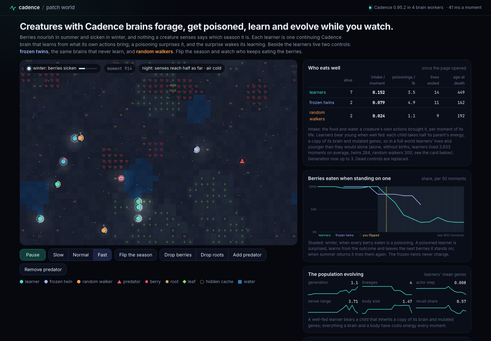
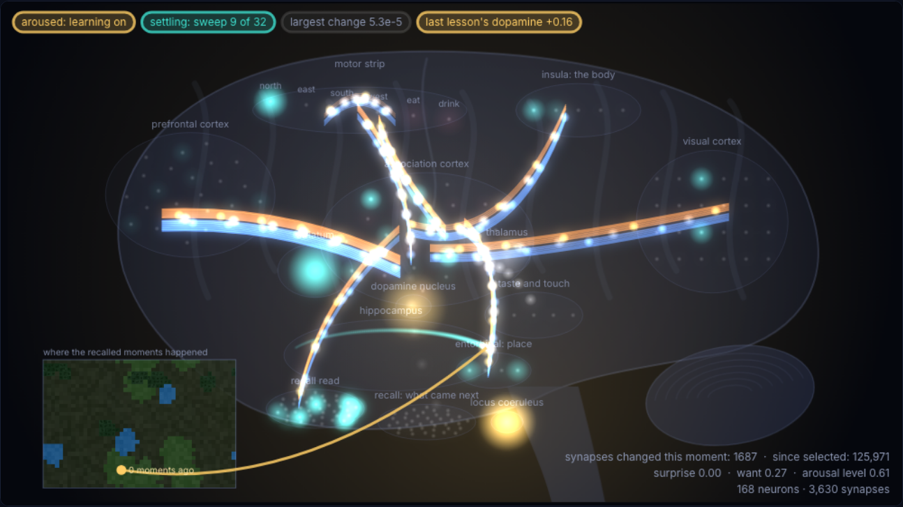

# Patch World

A world of creatures with Cadence brains, in your browser tab. Each creature forages, drinks,
flees a predator, gets poisoned and learns from it while it lives; well-fed creatures bear
young that inherit a copy of their brain and mutated genes. Berries nourish in summer and
sicken in winter, and nothing a creature senses says which season it is: to keep eating well
through the year a creature has to learn while it lives. Beside the learners live two
controls, frozen twins (the same brains, never learning) and random walkers.



Runs on `cadence-net==0.95.2`.

## Run

```sh
python3 -m http.server 8793 --directory patch-world/web   # from the repository root; open http://localhost:8793/
```

The first visit downloads Pyodide 314.0.7 and NumPy from jsDelivr. The page then starts one
worker for the world and two to four for the brains; each loads the released `cadence-net`
wheel, the `patchworld` sources and the founders' brains from `web/pack/`, checking every file
against the SHA-256 in `web/pack/manifest.json` before anything runs. No server chooses an
action. Nothing is saved in the browser; a reload starts a new world.

## What you see

- **The world.** A 48 x 32 torus: ground with roots, meadows with leaves, berry thickets, ponds,
  four hidden caches of nuts (marked for you, invisible to the creatures until they stand on
  one), day and night (at night the senses reach half as far), one predator. In winter the
  ground turns grey; the creatures do not see that.
- **The creatures.** Learners (teal, shaded by lineage; a gold spot at the back of the head
  marks a recall memory), frozen twins (blue, with a dashed ice rim) and random walkers (orange,
  with a question mark). Each faces the way it last walked; the ring around it is its stored
  energy; it turns green while it is sick. A learner glows gold while its brain is aroused and
  learning, and flashes gold or blue with the dopamine of each lesson.
- **Who eats well.** For each kind: alive, intake per moment (the food and water its own
  actions brought), poisonings per 1,000 moments, lives ended and mean age at death, since the
  page opened. In the page learners bear young, and each child takes half its parent's energy,
  so their lives end younger than in the measured worlds without births below.
- **Berries eaten when standing on one.** For learners and frozen twins, per 50 moments,
  winters shaded. After a flip into winter the learners' share falls within a few hundred
  moments; when summer returns it rises again. The twins' line does not move.
- **The population evolving.** The learners' mean generation, lineages, actor step, sense
  range, body size and recall share over time.
- **What happened.** Births, deaths, poisonings, and learners that were poisoned before walking
  past a berry.
- **Click a creature** to open its brain, drawn as a brain seen from the side. Every light is
  the creature's real state at this moment, read in its worker
  ([`patchworld/inspect.py`](patchworld/inspect.py), [`web/brainview.js`](web/brainview.js)):
  its neurons light with the activation they settle to, played sweep by sweep through the
  settle its action came from, with the sweep count and the largest change of each sweep;
  fibre tracts glow with the signal their synapses carry in the settled state (weight times
  presynaptic activation, warm excitatory, cool inhibitory), the senses' tracts entering
  through the thalamus, and shimmer white where this moment's lesson changed synapses (the count
  is shown); the dopamine nucleus washes the brain gold or blue with the prediction error of
  the lesson; the locus coeruleus glows with the arousal level and the brain brightens while it
  learns; the hippocampus lights the recall slots the memory read, each threaded to the place
  on a small map where it stored that moment. Regions are named for the role their Cadence
  population plays (hover one for what it is). Below: energy, thirst, arousal, its genes and its
  life so far.



Controls: pause, three speeds, **Flip the season**, **Drop berries** or **Drop roots** (click
the map), **Add predator** (up to four) and **Remove predator**.

## How a creature lives

Each learner is one `Brain.compose(38, 6, modules=..., arousal=True, ...)` brain
([`patchworld/brain.py`](patchworld/brain.py)). Every moment is one call:

```python
action = brain.live(observation, reward=[what_the_last_action_brought])
```

The senses (38 inputs, [`patchworld/world.py`](patchworld/world.py)): for each of four
directions the nearest berry, root, leaf, water, predator and other creature within its sense
range; what is underfoot (berry, root, leaf, cache, water beside it); its energy, thirst,
daylight, nausea (while a poisoning lasts) and the cold of the air, which follows the season
slowly (two thirds of the way in 250 moments), so for a while after a turn the air still feels
like the season before; and where it is. The actions: north, east, south, west, eat, drink.
The reward is what the last action brought: food energy, water when thirsty, poison, a bite,
a small cost for eating or drinking with nothing there.

Calm, the brain answers from one settle and learns nothing. A surprise (a berry that
poisons where berries used to nourish) or a want (an income below what its life usually pays)
rouses it, as does its youth: aroused, it samples its policy, learns from
the outcome through its eligibility traces and writes the outcome to its associative store.
The working trace carries its last interpretation into the next settle. With the `recall`
gene it also holds a recall memory of its recent moments.

Every part of a creature costs energy every moment: its neurons, a recall memory, its sense
range, its speed, its size, every learning sweep of an aroused moment; thirst and sickness
burn more. A creature that stores enough energy bears a child: the child takes half the
energy, a copy of the parent's brain as it is at that moment, and mutated genes (actor and
critic steps, temperature, eligibility, store rate, arousal threshold, need and heat, sense
range, speed, size, the share of capacity at which it bears young; a recall memory can be
grown onto the inherited brain with `brain.grow(recall=True)`). Up to 12 learners live at
once. Selection is only who eats, drinks, escapes and lives long enough to bear young.

The frozen twins carry a founder's brain and sample its policy at its own temperature
(`brain.act(observation, greedy=False)`) without ever learning. The founders were frozen at the
end of a summer, so the twins keep the habits of that summer. Random walkers draw one of the
six actions uniformly. Controls do not bear young; a dead control is replaced.

## How the founders were bred

[TRAINING.md](TRAINING.md) gives every stage with its command; all of it ran on one 64-vCPU
cloud machine in about 105 minutes of wall time. In short: a nursery raised 256 brains for
30,000 moments each in worlds where nobody dies; the eight best founded 32 islands of the
mortal world, where they lived, bred and died for 58,500 moments (round 1); the eight best
survivors of round 1 founded 48 islands for 118,500 moments more (round 2). The page's eight
founders are the best survivors of round 2, one per island, 35 to 67 generations after the
round-1 founders. They replaced the round-1 founders because they beat them on the same
fresh-seed readings (below and `evidence/round2-vs-round1-*.json`).

## Measured

Each reading below ran on fresh world seeds (100,000 on, unused by the breeding), with the
founders in `web/pack/founders/`; the receipts are in [`evidence/`](evidence/).

**Learners outlive their frozen twins and random walkers** (`evidence/controls.json`). Each of
the eight founders lives three times in one mortal world without births: as a learner, as its
frozen twin, beside a random walker; 32 worlds, up to 12,000 moments.

| | Learners | Frozen twins | Random walkers |
| --- | --- | --- | --- |
| Mean age at death (95% CI) | 3,933 (3,554 to 4,290) | 284 (248 to 324) | 300 |
| Intake per moment | 0.209 | 0.069 | 0.037 |
| Moments of 1,000 spent eating or drinking where there is nothing | 131 | 731 | 313 |

253 of the 256 learners outlived their own twin (paired difference 3,648 moments, 95% CI 3,277
to 4,005); 81 of the learners lived to the end of their lifespan (8,000 moments). The twins
starve long before the first winter: a twin keeps the habits its brain had when it was frozen
and eats on bare ground at most moments, while a learner, whose wasted eating costs it energy,
keeps correcting that within its life.

**After the season turns, learners stop eating the berries; frozen twins do not**
(`evidence/flip.json`). Learners and twins live through 1,000 moments of summer, then 1,500 of
winter, in a world where nobody dies; 32 worlds. The share of berries eaten when standing on one:

| | Last 100 of summer | Winter, 0-100 | 100-200 | 200-300 | 400-500 | 700-800 | Last 100 |
| --- | --- | --- | --- | --- | --- | --- | --- |
| Learners | 99% | 45% | 33% | 23% | 18% | 11% | 5% |
| Frozen twins | 97% | 98% | 100% | 100% | 97% | 100% | 96% |

A learner's first winter berry poisons it; the surprise rouses it, and the lessons of the next
few hundred moments take its acceptance towards a twentieth. The twins found fewer berries in
summer (0.35 per 100 moments against the learners' 1.95), and ate every one they stood on.

**The second winter goes better than the first** (`evidence/seasons.json`). Summer, winter,
summer, winter (1,000, 1,500, 1,500, 1,500 moments), 32 worlds, nobody dies. Berries eaten per
100 moments in the first 300 moments of each winter: learners 0.60 (95% CI 0.55 to 0.66) in the
first winter and 0.32 (0.27 to 0.38) in the second; the share of berries they ate when standing
on one, 9.8% over the first winter and 6.1% over the second. The frozen twins: 0.15 and 0.15,
98% and 97%. The learners came back to the berries slowly in the second summer: they ate 27% of
those they stood on, against 98% in the first.

**Evolution: the evolved lineages take over a shared world** (`evidence/evolution.json`,
`evidence/competition.json`, `evidence/round2-vs-round1-*.json`, `evidence/islands.json`). The
founders the islands started from (generation 0, arousal heat and need at zero as the islands
received them) against the page's founders, each group in its own mortal world without births,
32 worlds:

| | Generation 0 | Page founders (round 2) |
| --- | --- | --- |
| Intake per moment (95% CI) | 0.162 (0.155 to 0.169) | 0.212 (0.205 to 0.219) |
| Mean age at death (95% CI) | 2,968 (2,722 to 3,223) | 3,249 (2,982 to 3,506) |
| Brain cost, energy per moment | 0.0092 | 0.0122 |

Put together in one mortal world with births (8 founders a side, up to 16 learners, 12,000
moments, 32 worlds), the page founders' lineages held 89% of the learners at the end (95% CI
76% to 99%): every learner in 25 worlds, none in 3; they bore 4,363 young against 1,069. Both
sides lose learners in the first winter (the page founders from 11.6 after 1,000 moments to 5.7
after 2,000, generation 0 from 4.4 to 1.9); the page founders' lineages recover to between 9 and
14 for the rest of the run.

The founders of round 1 did less well. Against generation 0 in the same shared world they held
56% of the learners (95% CI 39% to 72%) and fell from 10.6 to 2.7 in the first winter; the round-2
founders held 82% (95% CI 68% to 96%) of a world shared with the round-1 founders. Without
births the round-1 founders took in 0.231 per moment and lived 2,494 moments. Across round 1
the survivors' sampling temperature fell (0.26 to 0.15), their associative store rate rose (0.19
to 0.30), their bodies grew (size 1.02 to 1.26), their sense range shrank (3.6 to 2.9 cells) and
the share carrying a recall memory rose from 0.25 to 0.55; across round 2 the actor step fell
(0.029 to 0.019), the sense range grew back (2.1 to 3.0), the bodies grew again (1.26 to 1.44),
the need rose (0.06 to 0.11) and the recall share fell to 0.51.

**Arousal heat: why the founders started without it** (`evidence/heat-on.json`,
`evidence/heat-off.json`). Heat widens the sampling of a brain in want. With the generation-0
brains as the nursery raised them (heat about 1, need 0.05), learners lived shorter lives than
their frozen twins (paired difference -451 moments, 95% CI -728 to -172); the same brains with
heat and need set to zero outlived their twins (925, 95% CI 629 to 1,217). A hungry learner
with heat samples its policy hotter and wanders where it should eat. The islands started with
heat and need at zero; mutation raised heat again in some lineages (the page's founders carry
0.38 to 1.62), and those learners still outlive their twins above.

**A recall memory did not help find the hidden caches** (`evidence/caches.json`). Sixteen
nursery pairs (same genes, same brain seed, raised 30,000 moments with and without the memory),
each pair in 16 fresh worlds for 3,000 moments where nobody dies: 0.98 nuts per 1,000 moments
with the memory, 1.05 without (paired difference -0.07, 95% CI -0.22 to 0.07); the memory did
better in 102 of 256 pairs, worse in 112.

**The page** (`evidence/page-check.json`, headless Chromium on an Apple M4): the page booted in 2.6 s with Pyodide cached; it ran 43.7 moments a second at full speed
(36 ms a moment) with 12 learners, 2 frozen twins and 2 random walkers in four brain workers,
the inspected learner's brain recorded sweep by sweep; the brain view drew a frame in 2.5 ms;
through a flip the learners kept living and the inspected learner's aroused moments grew; no
console errors.

## Limits

- The creatures' intake is far from what the world offers: learners still eat on bare ground
  131 moments in 1,000 and walk past food they sense. They are reward-trained from scratch
  without a teacher; competence is measured against the controls, not against an optimal
  forager.
- The frozen twins lose mostly through a stuck habit (eating where there is nothing), not
  through winter berries: they starve before the first winter in the mortal world. The winter
  readings come from worlds where nobody dies.
- After a winter the learners come back to the berries slowly (27% acceptance in the second
  summer against 98% in the first): what a poisoning taught outlasts the season that taught it.
- The recall memory gave no measurable advantage on the caches; selection spread it in round 1
  (0.25 to 0.55 of the survivors) and held it near half in round 2, and its role in that spread
  is not identified.
- Both groups in the shared-world reading lose learners in the first winter; the page founders
  recover, and how much of their lead comes from their summer habits at the start is not
  separated from what they learned over the rounds.
- Evolution here is selection of genes over brains that are inherited as copies (a child starts
  from its parent's brain), not evolution of newborn brains; the readings compare groups of
  founders, not single genes.
- Energy and costs are a declared simulation economy (`patchworld/world.py: Rules`,
  `patchworld/genes.py`); a low settling residual is the brain agreeing with itself, not a
  measure of good behaviour.
- In the page the inspected creature's brain is recorded sweep by sweep, which makes that
  creature's worker slower; the world's other brains run as in the receipts.

## Files

- `patchworld/`: the world (`world.py`), the genes (`genes.py`), the brains and the controls
  (`brain.py`), the brain view's readout (`inspect.py`), births, deaths and inheritance
  (`ecosystem.py`), the page's Python hosts (`host.py`), the measured scenarios
  (`scenarios.py`).
- `web/`: the page (`index.html`, `app.js`, `brainview.js`, `worker.js`, `styles.css`) and
  `web/pack/`, written by `pack.py`: the wheel, the sources and the founders.
- `training/`: `breed.py` (nursery, evolution, selection), `evaluate.py` (the scenarios and
  their receipts), `readings.py`, `seasons.py`, `islands.py`, `group.py`; commands in
  [TRAINING.md](TRAINING.md).
- `tests/`: `python -m pytest -q tests`. `check_page.py`: the page in headless Chromium
  (`pip install playwright`, `playwright install chromium`).
- `evidence/`: the receipts. [MODEL_CARD.md](MODEL_CARD.md): the founders.

GPL-3.0, as Cadence.
