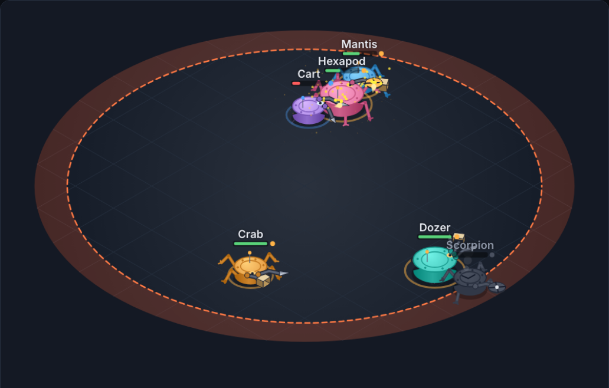
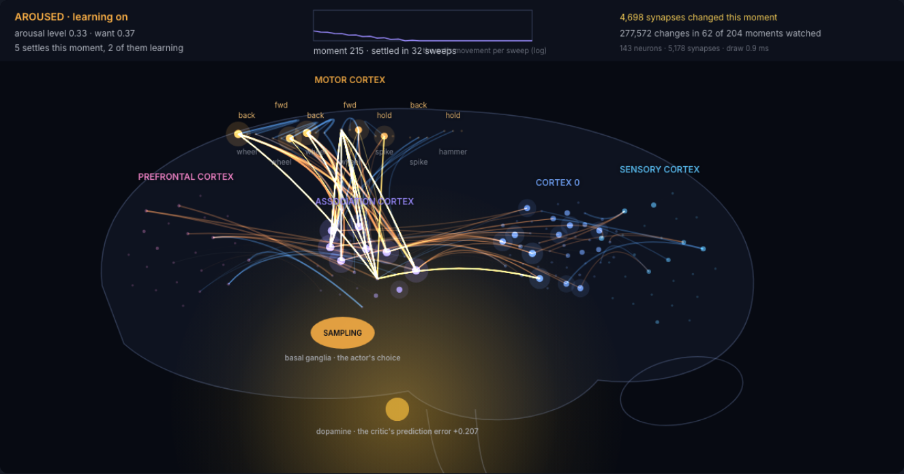

# Cadence Showcase League

Robots assembled from parts, each with one continuing Cadence brain wired to every motor.
A robot is nursed alone until it can drive, aim and stay inside a ring. Then it fights
six-robot royales for the rest of its life and keeps learning from every fight. Nothing is
reset between fights, and the page runs the fights live in your browser and saves every
brain there.



## See it

```sh
cd showcase-app && npm install && npm run build && npx vite preview --port 4173
```

Open http://localhost:4173/. `public/pack/` holds the six brains, the arena's Python and the
cadence-net wheel; Pyodide runs them in a worker. What to watch:

- the ladder's last column, the driving test each brain arrived with (eight marks: approach,
  escape, the closing ring, engagement, chase, facing, no spinning, no stalling);
- the "getting better" row: damage per robot per fight and moments in the burn, first third
  of your fights against the last third, and the share of calm moments;
- the brain inspector of the selected robot (click a robot), drawn as a brain seen from the
  side from the brain's own state in every moment: its senses entering the sensory cortex, the
  intermediate and association cortex, the prefrontal region where the working trace returns,
  the motor strip with every motor's command, the actor's choice (greedy when calm, sampling
  when aroused), the critic's reward prediction error as a gold or blue wash from a midbrain
  nucleus, the synapses a learning step changes, and, for brains with the recall memory, the
  stored moments it reads. Every eighth moment the act's settle replays sweep by sweep from
  `cadence.record_settlements`. Regions are named for the role their population plays.



Returning visitors get their own league back; "Reset the brains to how they arrived" starts
over.

The brains run on cadence-net 0.95.2, the same wheel in the page and in the native code.

The six packed robots were bred with `python -m arena.breed` (bodies and brain genes, about
110 generations over three populations on one 96-vCPU machine) and passed through
`python -m arena.gate` against the previous roster; their bodies, genes and every reading are
in [MODEL_CARD.md](MODEL_CARD.md). The gate as run:

| Test | Reading | Bar |
| --- | --- | --- |
| Head to head: 48 royales of three new and three previous robots | new minus previous placement +0.261, 95% interval [+0.128, +0.400] | interval above zero: met |
| Driving test, mean of the six | +0.391 (previous roster +0.22) | clearly above the previous: met |
| No brain significantly below a random twin (72 royales with the two twins) | none | met |
| The roster's placement minus the twins' in the same fights | +0.117, 95% interval [-0.024, +0.253], 70 fights | interval above zero: missed narrowly |

The owner chose to ship this roster because it beats the previous one on every measured
reading, including against the twins: in the previous roster's 20 royales the random Mantis
twin rated above five of its six brains.

## How a robot learns

**Nursery.** Alone with a dummy and a sparring partner, immortal, headless, tens of times
faster than real time. The world pays metres closed on the target, damage dealt and a
destroyed dummy; it charges damage taken and burns outside a standing ring. Nobody tells
the brain which motor is which.

**Driving test.** A frozen greedy copy of the brain is tested in open space: approach from
eight bearings, escape, come in when the ring closes, engage, chase, face the rival, no
spinning, no stalling. The score picks the best of a body's seeds; the marks are in the
page's manifest.

**Ring.** Six robots, a ring closing to 3.5 m over 2000 moments; damage dealt pays, damage
taken and the burn cost, closing on the nearest rival pays, finishing a rival pays a trophy,
placement pays at the end. In the ring the brain runs on a stage: calm unless surprised, a
sharp sampling temperature, and an actor step a thirtieth of the nursery's, so a fight
refines what the nursery built instead of overwriting it.

The settings behind this are in [docs/brain.md](docs/brain.md). The bodies in the parts
catalogue, the brain layout, the nursery, the driving test, the ring and every value are one
working set of choices, measured here, and nothing more: change any of them. Every brain
constant is a gene, so evolution changes them too.

## Train your own league

```sh
python3 -m venv .venv && .venv/bin/pip install -r requirements.txt "cadence-net[fast]==0.95.2"
export OMP_NUM_THREADS=1 NUMBA_NUM_THREADS=1
STAGE=$(.venv/bin/python -c 'import json; from arena.brain import PAGE_STAGE; print(json.dumps(PAGE_STAGE))')
.venv/bin/python -m arena --league league init                    # the stock bodies and two random twins
.venv/bin/python -m arena --league league nursery --moments 100000 --workers 8 --controls
.venv/bin/python -m arena --league league licence --all --random --workers 8
.venv/bin/python -m arena --league league royale --fights 20 --size 6 --duration 2400 --zone-moments 2000 --zone-end 3.5 --stage "$STAGE"
.venv/bin/python -m arena --league league dashboard               # league/index.html, replays with the inspector
cd showcase-app && ../.venv/bin/python pack.py --league ../league --robots 6 && npm run build
```

`cadence-net[fast]` adds the compiled CPU path: one nursery moment took 14.5 ms against 81 ms
without it on the same loaded machine. On an Apple M4 a batch of eight 100,000-moment nursery
lives took 36 to 43 minutes and the 20 royales 7. The shipped roster raised three seeds of
each body (the blueprint's `seed`) this way and kept the seed with the best driving test.

`python -m arena.breed --help` breeds bodies and brain genes against a fixed reference pool:
every generation the newborns go through the nursery, every robot fights royales of six
against anchors (the shipped brains, reloaded fresh for every fight, and the random twins),
and takes the driving test. Fitness is the placement against the pool, plus the driving test,
plus a share for damage dealt, less a cost for slower brain layouts. The genes include the
layout (one or two cortical regions from 64 to 256 neurons), the recall memory, the teaching
point, the actor's rates, the efference copy, the arousal law and the sensory scale;
`--niche` keeps the best of every lineage, `--lock-class` keeps a lineage's chassis, locomotion
and weapon kinds, and `--refresher-moments` gives the survivors more nursery. `python -m
arena.gate` is the test a new roster passes before it ships: mixed royales against the shipped
roster with a bootstrap interval, the driving test, and royales against the random twins.

`python -m arena evolve --help` breeds lineages: mutants of body and genes are born with
newborn brains, raised, fought on the stage and ranked by the driving test; the best of
every lineage stay with their brains. `tests/` checks the physics, the senses, the brain
wrapper, the nursery, the royale and the page's pack.

## From showcase to game

This could be a great game: players assemble robot bodies and brains from the parts
catalogue, train them, and let them fight in a robot arena, where every robot keeps its one
life and learns from every fight.

## Layout

`arena/` the parts catalogue, physics, senses, brain wrapper, nursery, royale, licence,
league, evolution and dashboard; `viewer/` the isometric replay page and the league page;
`showcase-app/` the page and its packer; `league-live/` the roster the page ships with;
`tests/` the checks; `docs/` the brain settings and screenshots.
