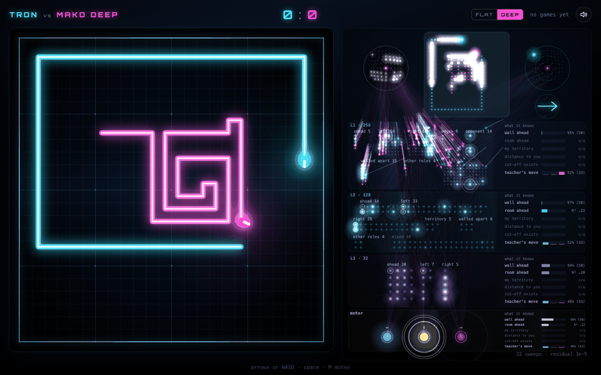
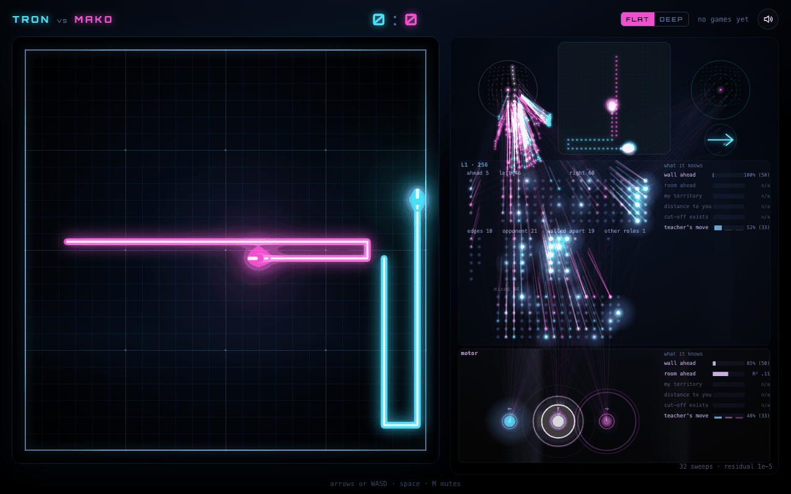

# Tron

Ride a light cycle against a Cadence brain that runs in your browser tab. The brain sees the
whole arena and answers every move with one settle of the whole brain; the panel beside the arena
draws every neuron of it, layer by layer, sweep by sweep. Two brains are on the page: a flat one
of one region and a deep one of three regions whose deep layers decide three quarters of its
moves. Pick one with the switch in the header.





Runs on `cadence-net==0.95.2`.

## Play

```sh
python3 -m http.server 8831 --directory web   # from tron/; open http://localhost:8831/
```

`?brain=deep` (the default) or `?brain=flat` picks the brain. Arrows or WASD steer, space starts a
round, M mutes; on a phone, swipe to steer and tap to ride. Your record against each brain is kept
in this browser, apart for each brain.

The first visit downloads Pyodide 314.0.7 and NumPy from jsDelivr. The wheel, the host sources and
the brain are in `web/pack/<flat|deep>/`; the worker checks each file against the SHA-256 in that
pack's `manifest.json` before anything runs. No server chooses the moves.

## The brains

Both are Cadence brains with three motor neurons (turn left, ride straight, turn right), no recall
memory and the working trace at amplitude 0: the flat one from `Brain.compose`, the deep one from
`Brain.compose(connectome=...)` with a custom anatomy (below). Every move is

```python
brain.reset()
move = brain.act(field(arena, seat)[None, :], greedy=True)
```

frozen and greedy, settled from rest. Nothing is learned while you play, so a round is fully
determined by the arena seed and your moves.

**The senses (2,470 inputs, [`tron/field.py`](tron/field.py)).** The whole 24 x 24 arena at full
resolution, turned so that the rider's heading points up: "a wall ahead" is the same input
whatever the compass heading. Four planes (blocked cells, the opponent's trail, its own head, the
opponent's head), a 9 x 9 fovea around its head (blocked cells, the opponent's head) and the
opponent's heading relative to its own.

| | Flat (Mako) | Deep (Mako Deep) |
| --- | --- | --- |
| Layout | one region of 256 | 256 → 128 → 32 |
| Neurons, synapses | 2,985 · 699,398 | 2,921 · 708,806 |
| Against `voronoi`, 256 games on seeds 2,200,000+ | 186-68-2, 0.73 | 160-96, 0.63 |
| Against `voronoi`, 256 games on seeds 7,000,000+ | 182-74, 0.71 | 170-86, 0.66 |
| Read again on 0.95.2, 64 games on seeds 2,200,000+ | 48-16, 0.75 | 40-24, 0.63 |

A mirror pair plays one arena seed twice, the brain in either seat; draws count half. `voronoi`
moves to the cell that leaves it the most cells it reaches before its opponent, one move ahead for
both riders. The original readings are in [`brains/`](brains/); the 0.95.2 re-reading is
[`evidence/reading-0952.json`](evidence/reading-0952.json).

**The deep brain's deep layers play.** It was built from the flat line with a skip connection from
its first layer to the motor neurons, and the skip was weakened in stages while the deep pathway
learned the moves. With the deep pathway cut (its 73,920 synapses at zero) it changes 75% of its
moves and loses every game against `voronoi`.

The brain view draws what each layer computes: for each neuron, the event or number its firing
tracks best in played positions (a wall within two cells ahead, the opponent close on the right,
the share of the free board it reaches first), kept only where silencing or driving that neuron
changes the move. [`web/pack/deep/brain/ROLES.md`](web/pack/deep/brain/ROLES.md) and
[`web/pack/flat/brain/ROLES.md`](web/pack/flat/brain/ROLES.md) list them with their evidence
([`scripts/introspect.py`](scripts/introspect.py)).

## How they were raised

[TRAINING.md](TRAINING.md) gives every stage with its command, its hardware and time, and its
readings, and a smoke-scale run of each route that takes minutes. In short:

- **Flat:** a genetic search over `Brain.compose` settings (1,536 raisings), the winner raised by
  corpus lessons and DAgger, then expert iteration (an alpha-beta search with the brain's own move
  as a prior labels each position it reaches), selection between short branches, and self-play
  against its own past generations and a pool of bots and brains.
- **Deep:** a flat brain of the same line (Mako 1.6) grafted into the first layer of a
  (256, 128, 32) brain with a skip from that layer to the motor neurons, so it starts with the
  flat brain's play; self-play; then, five times, the skip halved and the deep pathway taught that
  brain's moves with the first layer and the skip frozen.

## Limits

- **The brain alone, no search.** The page plays one settle per move. Bots that look further
  ahead beat it: the flat brain scores 0.20 against `voronoi2`, 0.25 against `voronoi3` (two and
  three rounds of look-ahead) and 0.14 against `ab5` (a 10-ply alpha-beta), 128 games each; the
  deep brain is weaker than the flat one against `voronoi`. A tree search guided by the brain is
  in [TRAINING.md](TRAINING.md#a-brain-guided-search) as work in progress.
- **Frozen while you play.** These brains do not learn from your games.
- **Settled is not right.** A settled state certifies the settle's equations at the tolerance,
  not the quality of the move.
- **Strength readings are per seed set.** Games from one start seed are correlated, so two seed
  sets of 128 pairs can differ by more than the interval of either.

## Layout

| Path | What |
| --- | --- |
| `web/` | the page: `js/main.js` (game, clock, record), `js/arena.js`, `js/deep.js` and `js/ripple.js` (the brain view), `js/worker.js` (Pyodide) |
| `web/pack/flat/`, `web/pack/deep/` | the wheel, the host sources, the brain, its meta and its introspection, with `manifest.json` |
| `tron/` | the arena (`world.py`), the sense (`field.py`), the page's host (`fieldhost.py`), the bots (`bots.py`, `fastbots.py`, `absearch.py`), the schools and the search |
| `scripts/` | training, selection, self-play, the deep constructions, readings, introspection |
| `brains/` | each brain's meta: layout, readings, lineage; [MODEL_CARD.md](MODEL_CARD.md) describes both |
| `pack.py` | packs one brain into `web/pack/<slot>/` |
| `tests/` | the rules, the bots, the packs (`pytest`), and `play_check.py`, the page tried in headless Chromium |
| `evidence/` | readings on 0.95.2 and the page check |

```sh
python -m venv .venv && .venv/bin/pip install -r requirements.txt
.venv/bin/python -m pytest tests -q
.venv/bin/python -m playwright install --only-shell chromium
.venv/bin/python tests/play_check.py
```

Cadence and this example are GPL-3.0. See the [Cadence source](https://github.com/muellerberndt/cadence).
